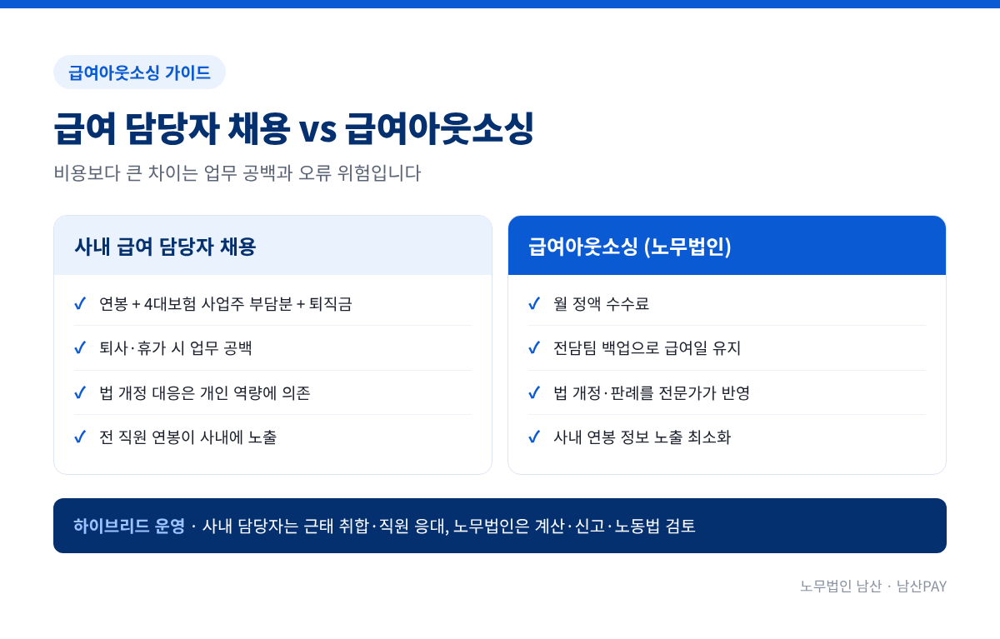

직원 수가 수십 명 규모인 기업이라면 <strong>전담 직원을 채용하는 인건비보다 급여아웃소싱 비용이 훨씬 경제적</strong>입니다. 그러나 대표자와 인사팀장이 주목해야 할 더 본질적인 차이는 비용이 아니라, <strong>담당자 퇴사 시 발생하는 업무 공백과 법적 오류 리스크</strong>입니다.

### 사내 채용 vs 급여아웃소싱 핵심 비교

| 비교 항목 | 사내 급여 담당자 채용 | 급여아웃소싱 (노무법인) |
| :--- | :--- | :--- |
| <strong>투입 비용</strong> | 연봉 + 4대보험 사업주 부담분 + 퇴직금 + 급여 프로그램 이용료 | 월 정액 수수료 |
| <strong>퇴사·휴가 시</strong> | 즉각적인 업무 공백, 재채용 및 인수인계 교육 비용 발생 | 내부 전담팀 백업으로 급여일·신고 기한 유지 |
| <strong>노동법 개정 대응</strong> | 담당자 개인의 실무 역량과 공부에 의존 | 법 개정·판례 변화를 전문가가 즉시 반영 |
| <strong>회사 사정 이해</strong> | 사내 맥락 파악에 유리함 | 변동 사항을 자료로 정리해 전달해야 함 |
| <strong>연봉 정보 보안</strong> | 전 직원 연봉이 사내 특정 직원에게 노출됨 | 사내 연봉 정보 노출 최소화 |

### 무조건 아웃소싱이 답은 아닙니다: '하이브리드 운영' 전략
인사 변동이 매우 잦고 현장·직원과의 실시간 소통이 많은 사업장이라면 사내 담당자가 반드시 필요합니다. 이럴 때 많은 성장 기업이 선택하는 방식이 <strong>역할 분담형(하이브리드) 운영</strong>입니다.

* <strong>사내 담당자:</strong> 근태 취합, 입·퇴사 변동 정리, 직원 1차 응대 등 내부 소통에 집중
* <strong>노무법인(아웃소싱):</strong> 정확한 급여 계산, 4대보험 신고, 노동법 기준 검토 등 전문·반복 업무 전담

18년간 과태료 처분 등 문제없이 다양한 업종의 급여를 관리해 온 노무법인 남산의 경험에 비추어 볼 때, 사내 직원이 핵심 인사 업무에 집중하고 법적 리스크가 따르는 급여·신고를 노무사에게 원스톱으로 맡기는 구조가 가장 안정적입니다.

### 자주 묻는 질문 (FAQ)
<strong>Q. 직원 수가 몇 명부터 사내 급여 담당자를 뽑는 게 맞나요?</strong>  
절대적인 인원 기준은 없습니다. 단순 인원수보다 <strong>사업장 개수, 교대근무 등 근무형태의 복잡도, 입·퇴사 빈도</strong>가 사내 담당자 필요 여부를 가르는 더 큰 기준입니다.

<strong>Q. 현재 경리·회계 직원이 급여 업무를 겸직하고 있는데 괜찮을까요?</strong>  
겸직 자체가 문제는 아니지만, <strong>수당과 퇴직금 계산 기준만큼은 반드시 한 번 점검받아 보시길 권합니다.</strong> 실무에서 통상임금이나 연장수당 산정 오류가 가장 빈번하게 발생하는 유형이 바로 비전공·겸직 담당자가 관행대로 계산해 온 경우입니다.

> <strong>급여아웃소싱 상담</strong>  
> 노무법인 남산 급여아웃소싱팀 이슬 팀장 · 02-585-7747~8 · namsan@namsanhr.com · namsanpay.com
