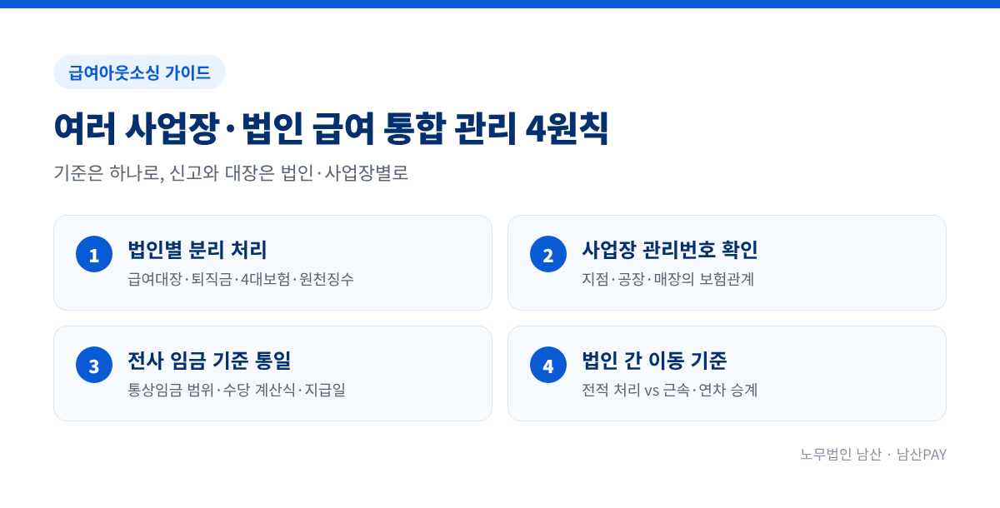

법인이나 사업장이 여러 개인 기업은 매장·지점마다 근무형태와 신고 주체가 달라져 급여 관리 난이도가 급격히 올라갑니다. 이를 여러 업체나 각 지점 담당자에게 흩어 맡기면 관리 통제가 무너집니다. 한 곳의 노무법인에 통합 위탁하면 <strong>임금 계산 기준은 하나로 통일하되, 법적 신고와 대장은 사업장·법인별로 정확히 분리</strong>해 관리할 수 있습니다.

### 다수 사업장·법인 통합 관리의 4가지 원칙

1. <strong>법인별 철저한 분리 처리</strong>  
   법인이 다르면 근로기준법상 '사용자'도 완전히 다른 별개의 회사입니다. 따라서 급여대장, 퇴직금 산정, 4대보험 신고, 원천징수 내역은 반드시 법인별로 명확히 구분해 처리해야 합니다.
2. <strong>사업장별 4대보험 관리번호 확인</strong>  
   같은 법인 산하에 있더라도 본사 외 지점·공장·직영 매장 등이 별도의 보험관계(사업장 관리번호)로 성립되어 있는지 확인하고, 각 번호에 맞춰 정확히 신고해야 합니다.
3. <strong>전사적 임금 기준의 통일</strong>  
   신고는 따로 하더라도 통상임금 산입 범위, 수당 계산식, 급여 지급일, 근태 집계 양식은 전사적으로 통일하는 것이 좋습니다. 기준이 같아야 대표자가 사업장별 인건비 효율을 한눈에 비교할 수 있고, 담당자 착오도 줄어듭니다.
4. <strong>법인·사업장 간 인사이동(전보·전적) 기준 정립</strong>  
   직원이 A법인에서 B법인으로 이동할 때 기존 법인에서 퇴사·정산 후 신규 입사로 처리할지(전적), 근속연수와 연차를 그대로 승계할지 사전에 명확한 인사 기준을 세워두어야 추후 퇴직금 분쟁을 예방할 수 있습니다.

### 자주 묻는 질문 (FAQ)
<strong>Q. 여러 법인을 한 번에 맡기면 아웃소싱 비용은 법인별로 따로 산정되나요?</strong>  
각 법인별 관리 인원 규모, 근무형태의 복잡도, 위탁 업무 범위를 종합적으로 검토해 가장 합리적인 비용 구조를 제안해 드립니다.

<strong>Q. 여러 매장을 운영하는 프랜차이즈 직영점도 통합 관리가 가능한가요?</strong>  
물론 가능합니다. 18년간 과태료 처분 등 문제없이 다양한 업종의 다수 사업장을 관리해 온 노하우를 바탕으로, 각 매장의 근태 자료만 표준 양식으로 취합하면 본사에서 전 지점의 급여와 4대보험을 원스톱으로 통제하실 수 있습니다.

> <strong>급여아웃소싱 상담</strong>  
> 노무법인 남산 급여아웃소싱팀 이슬 팀장 · 02-585-7747~8 · namsan@namsanhr.com · namsanpay.com
