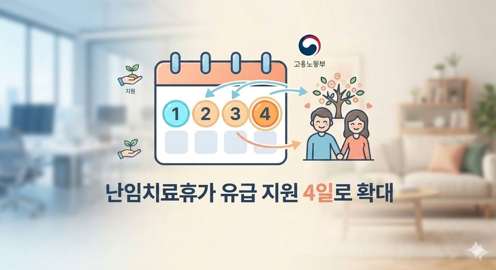
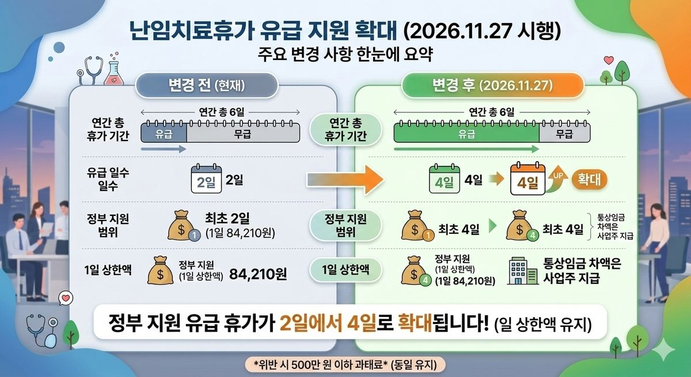

2026년 11월 27일부터 난임치료휴가 중 유급으로 처리해야 하는 기간이 2일에서 4일로 늘어납니다. 남녀고용평등법과 고용보험법 개정에 따른 것으로, 고용노동부 [보도자료](https://www.moel.go.kr/news/enews/report/enewsView.do?news_seq=19295)에 자세한 내용이 나와 있습니다.

## 무엇이 바뀌나

**유급 기간 4일로 확대**
난임치료휴가 6일 가운데 지금까지는 최초 2일만 유급이었습니다. 시행일 이후에는 최초 4일을 통상임금으로 지급해야 합니다. 인공수정·체외수정 등 시술 당일뿐 아니라 시술 전후 회복이나 준비를 위해 병원에 가는 날에도 쓸 수 있습니다.

**우선지원대상기업 정부 지원도 4일로**
우선지원대상기업(중소기업)은 고용보험에서 난임치료휴가급여를 지원받습니다. 지원 기간도 2일에서 4일로 늘고, 휴가 시작일 기준 통상임금을 지원하되 상한액은 336,840원입니다. 근로자 통상임금이 상한액보다 많으면 차액은 회사가 지급해야 합니다.

**위반 시 과태료**
근로자가 청구했는데 정당한 사유 없이 휴가를 주지 않거나 유급 기간을 무급으로 처리하면 500만 원 이하의 과태료 대상입니다.

## 사업장에서 확인할 것

- **취업규칙·휴가 규정**: 난임치료휴가 유급 기간이 '2일'로 적혀 있다면 '4일'로 고쳐야 합니다.
- **증빙 서류**: 휴가 신청 시 난임치료 시술 사실을 확인할 수 있는 서류(진료확인서 등)를 받도록 미리 안내해 두는 것이 좋습니다.
- **부서장 공유**: 현장 관리자가 휴가를 거절하거나 결근으로 처리하는 일이 없도록 개정 내용을 알려 주십시오.
- **급여 반영**: 11월 27일 이후 사용분부터 4일 유급이 적용되므로, 해당 월 급여에서 유급 일수와 차액 지급분을 확인해야 합니다.

