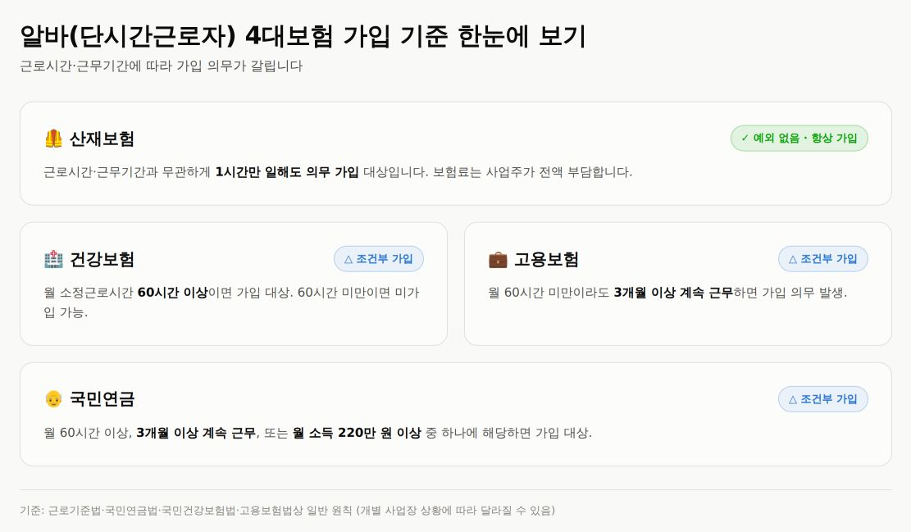
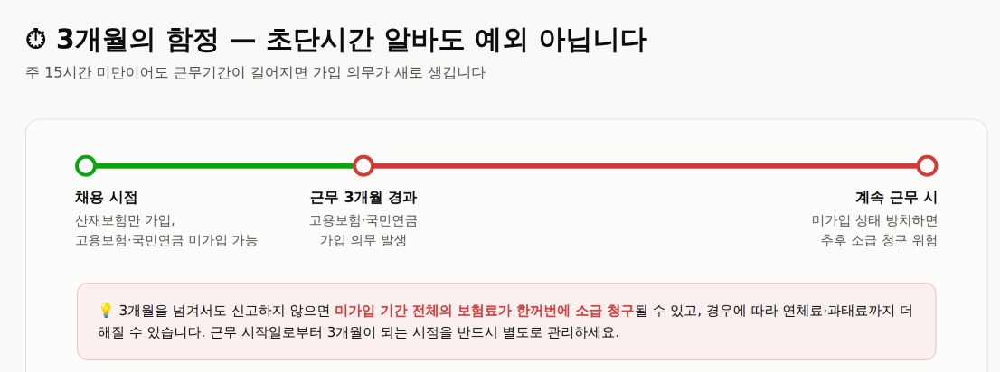

"단기로 잠깐 일하는데 꼭 가입해야 하나요?", "3.3% 떼고 프리랜서로 처리하면 4대보험 안 내도 된다던데요?" 아르바이트를 쓰는 사업장에서 자주 받는 질문입니다.

결론부터 말씀드리면, 근로자에 해당하고 가입 요건을 채웠다면 근로자와 합의했더라도 가입하지 않을 수 없습니다.

## 보험별 가입 기준

- **산재보험**: 근무 시간이나 기간과 관계없이 하루만 일해도 적용됩니다. 보험료는 사업주가 전액 부담합니다.
- **고용보험**: 1개월 소정근로시간이 60시간(주 15시간) 이상이면 가입 대상입니다. 그보다 짧더라도 3개월 이상 계속 근무하면 가입 대상이 됩니다.
- **국민연금·건강보험**: 1개월 소정근로시간이 60시간 이상이면 가입 대상입니다. 일용직은 한 달에 8일 이상 일하면 포함됩니다.

주 15시간 미만으로 일하는 초단시간 아르바이트라면 국민연금·건강보험은 대상이 아닐 수 있지만, 산재보험은 예외 없이 적용됩니다.

## 3개월이 지나는 시점을 놓치기 쉽습니다

처음에는 단기로 생각하고 뽑았는데 근무가 길어지는 경우가 많습니다. 근로시간이 짧아도 3개월 이상 계속 근무하면 고용보험 가입 대상이 되고, 국민연금도 근무 형태에 따라 대상이 될 수 있습니다.

이 시점을 모르고 계속 미가입으로 두면 나중에 미가입 기간 전체 보험료가 소급 청구되고, 연체금이나 과태료가 붙을 수 있습니다. 채용할 때 3개월이 되는 날을 따로 적어 두고 확인하는 것이 안전합니다.

## 3.3%로 처리하면 빠질 수 있을까

인건비 부담이나 신고가 번거롭다는 이유로 아르바이트생을 사업소득자(3.3%)로 처리하는 사업장이 있습니다. 하지만 계약서 형식만 프리랜서라고 해서 가입 대상에서 빠지지 않습니다.

정해진 시간에 출근하고, 사업주의 지시를 받으며, 시급이나 월급을 받는다면 실질은 근로자입니다. 이런 경우 3.3%를 떼고 있었더라도 근로자로 보고 4대보험을 소급 적용할 수 있습니다.

## 실무에서 확인할 것

- 근로계약서에 소정근로시간을 분명하게 적었는지
- 주 15시간(월 60시간) 미만인지 정확히 계산했는지
- 입사일로부터 3개월이 되는 날을 따로 관리하고 있는지
- 근로시간과 관계없이 산재보험은 신고했는지

## 가입하지 않았을 때

**사업주**는 적발되거나 신고가 들어오면 밀린 보험료를 한꺼번에 내야 하고, 과태료가 부과될 수 있습니다. 특히 산재보험 미가입 상태에서 사고가 나면 보험급여의 일부를 사업주가 부담하게 됩니다.

**근로자**는 당장 월급에서 보험료가 빠지지 않아 손에 쥐는 돈이 많아 보이지만, 나중에 실업급여를 받지 못하거나 국민연금 가입 기간이 비게 되는 불이익이 있습니다.

## 자주 묻는 질문

**아르바이트생이 먼저 가입하지 않겠다고 하면요?**
가입 요건을 채운 근로자라면 본인이 원하지 않아도 빼 줄 수 없습니다.

**초단시간 근로자도 산재 처리가 되나요?**
네. 근로시간과 관계없이 산재보험이 적용됩니다.

**3개월이 지나면 언제부터 가입하나요?**
3개월을 넘겨 계속 근무하는 시점부터 가입 의무가 생기는 것으로 봅니다. 신고 시점과 소급 여부는 사안마다 다를 수 있어 확인이 필요합니다.

