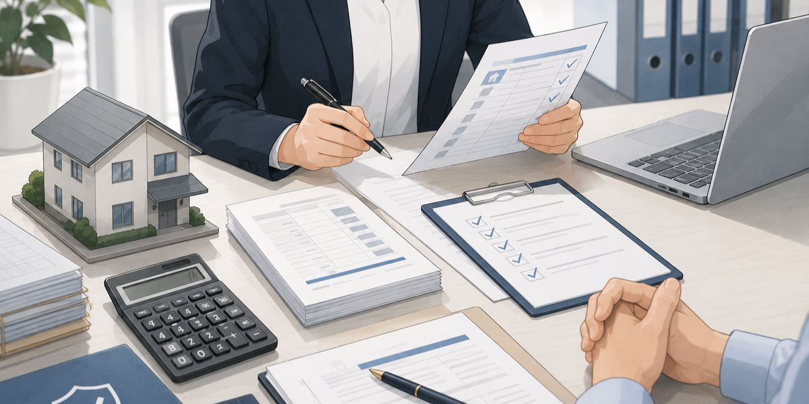
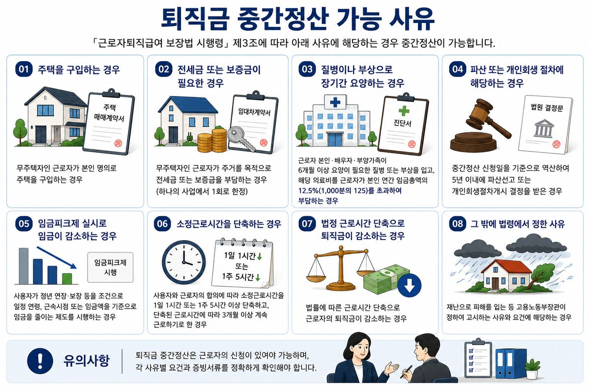
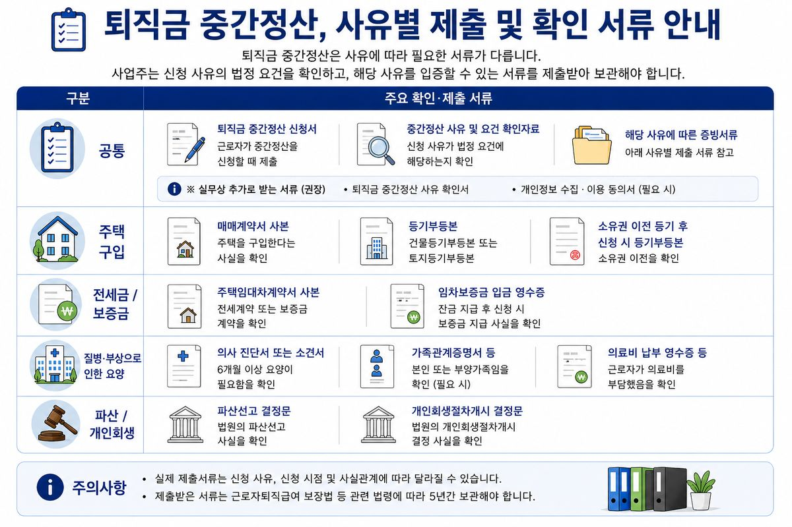
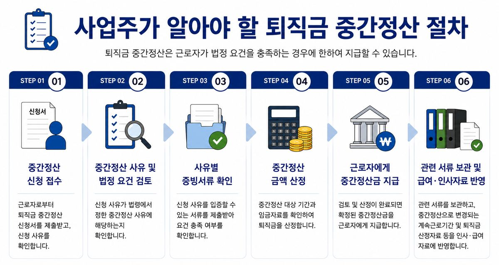

"개인 사정이 있어서 퇴직금을 미리 받을 수 있을까요?" 직원에게서 이런 요청을 받는 경우가 종종 있습니다.

퇴직금은 퇴직할 때 한 번에 지급하는 것이 원칙입니다. 중간정산은 근로자퇴직급여 보장법에서 정한 사유가 있고, 그 사유를 증명하는 서류를 갖춘 경우에만 할 수 있습니다. 사유·절차·서류 가운데 하나라도 빠지면 나중에 퇴직금을 다시 지급하라는 분쟁으로 이어질 수 있습니다.

## 자주 받는 질문

**직원 사정이 딱한데, 법정 사유가 아니어도 지급하면 안 되나요?**
안 됩니다. 법정 사유 없이 지급한 돈은 퇴직금으로 인정되지 않고 미리 빌려준 돈처럼 취급될 수 있습니다. 직원이 퇴사하면서 퇴직금을 다시 청구하면 회사가 두 번 지급하게 될 위험이 있습니다.

**전세금 명목으로 중간정산을 받았는데, 1년 뒤에 또 신청할 수 있나요?**
무주택자의 전세금·보증금 부담 사유는 같은 사업장에 다니는 동안 한 번만 인정됩니다.

남산PAY는 중간정산 사유 검토부터 퇴직금 산정, 급여 반영까지 함께 처리합니다.

