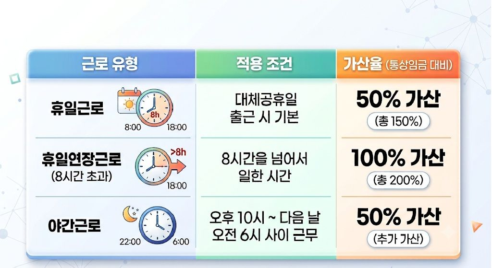

명절 연휴나 어린이날이 주말과 겹치면 대체공휴일이 지정됩니다. 이날 쉬면 급여는 어떻게 되는지, 출근해서 일하면 수당을 얼마나 더 줘야 하는지 자주 질문을 받습니다.

## 대체공휴일도 유급휴일입니다

상시 근로자 5인 이상 사업장이라면 대체공휴일도 법정 유급휴일입니다. 근로기준법 개정으로 관공서 공휴일(대체공휴일 포함)이 민간기업에도 단계적으로 적용되었고, 2022년부터는 5인 이상 사업장 모두가 대상입니다.

- **5인 이상 사업장**: 대체공휴일에 쉬어도 일한 것과 같이 임금을 지급합니다.
- **5인 미만 사업장**: 관공서 공휴일 규정이 적용되지 않습니다. 취업규칙이나 근로계약서에 따로 정한 것이 없다면 무급으로 처리할 수 있습니다.

## 대체공휴일에 일했다면

5인 이상 사업장에서 대체공휴일에 일하면 휴일근로 가산수당을 지급해야 합니다.

- **8시간 이내**: 통상임금의 150%
- **8시간을 넘는 부분**: 통상임금의 200%

월급제 근로자는 쉬는 날의 임금(100%)이 이미 월급에 들어 있으므로, 일한 시간에 대해 150%(8시간 이내) 또는 200%(8시간 초과분)를 따로 더 지급합니다.

휴일에 오래 일하거나 밤 10시 이후까지 일하면 연장·야간 가산이 겹쳐 붙습니다.

## 계산 예시

통상시급 10,000원인 직원이 대체공휴일에 오전 9시부터 오후 8시까지(휴게 1시간 제외) 10시간 일한 경우입니다.

- 오전 9시~오후 6시(8시간): 8시간 × 10,000원 × 150% = 120,000원
- 오후 6시~8시(2시간, 8시간 초과): 2시간 × 10,000원 × 200% = 40,000원
- **휴일근로수당 합계: 160,000원**

오후 10시 이후까지 일했다면 그 시간에는 야간근로 가산 50%가 더 붙습니다.

## 자주 묻는 질문

**대체공휴일 대신 다른 평일에 쉬게 해도 되나요?**
됩니다(휴일대체). 다만 근로자대표와 서면으로 합의해야 하고, 대신 쉴 날을 미리(통상 24시간 전까지) 정해 알려야 합니다. 적법하게 휴일을 바꿨다면 대체공휴일에 일한 것은 평일 근무가 되어 휴일근로 가산수당이 생기지 않습니다.

**대체공휴일과 주휴일(일요일)이 겹치면 수당을 두 번 받나요?**
아닙니다. 유급휴일이 겹치면 근로자에게 유리한 하나만 인정한다는 것이 고용노동부 행정해석입니다.

