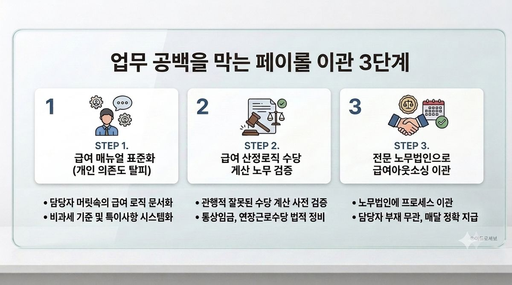

인사·재무 책임자나 대표가 급여일에 가장 곤란해지는 순간은 급여 담당자가 갑자기 그만두거나 오래 자리를 비울 때입니다.

급여 업무는 엑셀에 숫자를 넣는 일이 아닙니다. 회사마다 다른 수당 체계, 비과세 항목, 연장·야간·휴일수당 계산 방식, 4대보험과 원천세 신고까지 노무와 세무 기준이 함께 들어가 있습니다. 그런데 이 내용이 담당자 한 사람의 머릿속이나 엑셀 파일 하나에만 남아 있는 회사가 많습니다.

## 인수인계 없이 담당자가 빠지면

- **지급 지연과 계산 오류**: 수당을 잘못 계산하거나 급여일을 넘기면 직원들의 불만과 불신으로 이어집니다.
- **법 위반**: 통상임금을 잘못 산정해 임금이 체불되거나, 임금명세서 필수 기재사항이 빠져 과태료를 받을 수 있습니다.
- **신고 누락**: 보수총액 신고나 취득·상실 신고 기한을 놓쳐 과태료와 가산금이 붙습니다.

급여가 한 사람의 역량에만 기대고 있다면, 그 사람의 퇴사가 곧 회사 전체의 노무 위험이 됩니다. 사람이 바뀌어도 그대로 돌아가는 급여 체계로 바꿔 두어야 하는 이유입니다.

남산PAY는 회사별 급여 계산 방식을 먼저 정리하고, 근로기준법과 4대보험 기준에 맞는지 검토한 뒤 매월 급여를 처리합니다. 담당자가 바뀌어도 급여일은 그대로 지켜집니다.

