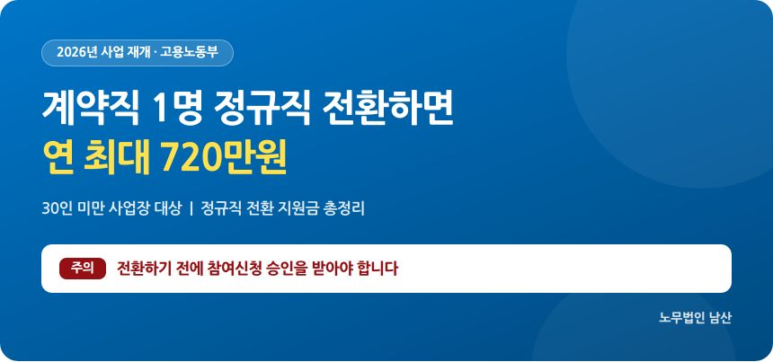
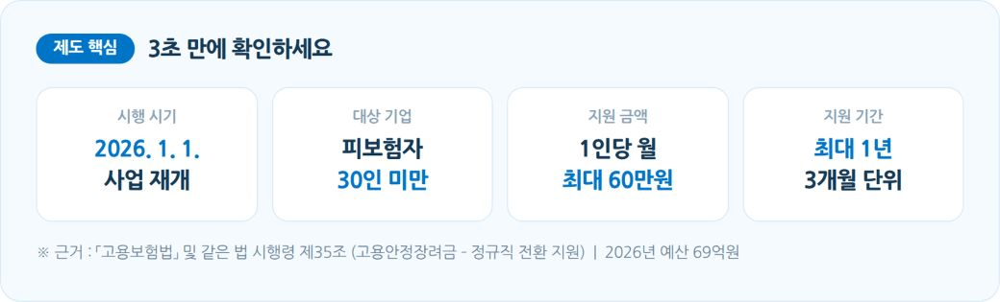
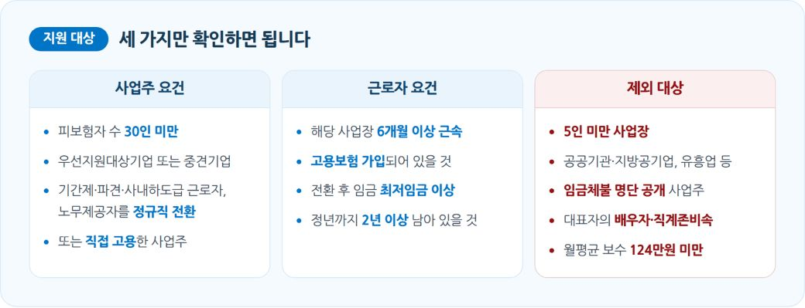
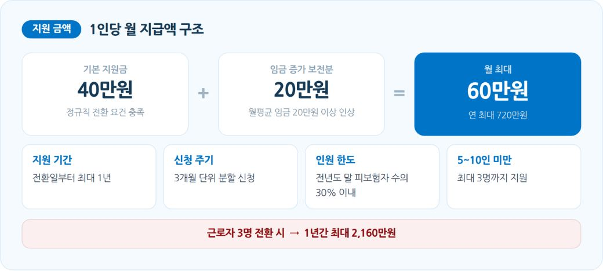
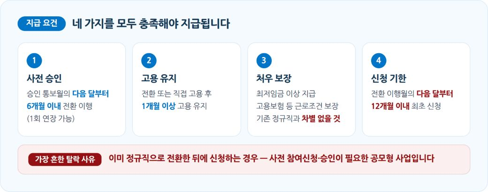
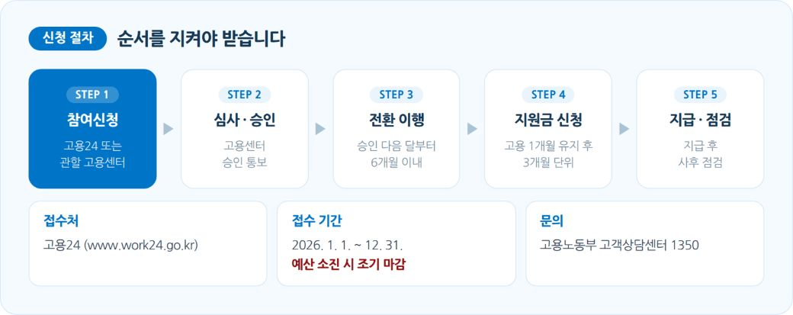

기간제 직원의 계약 만료를 앞두고 정규직 전환을 고민하는 사업주가 많습니다. 계속 함께 일하고 싶은데 인건비가 걱정이라면 고용노동부의 정규직 전환 지원금을 먼저 확인해 보시기 바랍니다.

## 정규직 전환 지원금이란

고용보험법 시행령 제35조에 근거한 고용안정장려금의 하나입니다. 기간제·파견·사내하도급 근로자나 노무제공자를 정규직으로 전환하거나 직접 고용한 사업주에게 인건비 일부를 지원합니다.

한동안 중단됐던 이 사업은 2026년 1월 1일부터 다시 시작됐습니다. 예산은 69억 원이고, 인건비 부담으로 전환을 망설여 온 30인 미만 사업장을 중심으로 지원합니다. 고용노동부 발표에 따르면 2026년 6월 말까지 740개 사업장, 1,247명이 승인되어 연간 목표의 62%를 채웠고, 업종별로는 보건·사회복지업이 29.7%로 가장 많았습니다.

## 지원 대상

**사업주**
- 고용보험 피보험자 수 30인 미만인 우선지원대상기업 및 중견기업
- 기간제·파견·사내하도급 근로자 또는 노무제공자를 정규직으로 전환하거나 직접 고용한 경우
- 제외: 5인 미만 사업장, 공공기관·지방공기업, 유흥업 등 지원 제외 업종, 임금체불 명단 공개 사업주, 중대산업재해 공표 중인 사업장

**전환 대상 근로자**
- 해당 사업장에서 6개월 이상 근속한 기간제·파견·사내하도급 근로자, 또는 6개월 이상 상시적으로 노무를 제공한 노무제공자
- 고용보험에 가입되어 있을 것
- 전환 후 임금이 최저임금 이상이고, 전환 시점에 정년까지 2년 이상 남아 있을 것
- 제외: 고용보험 미가입자, 사업주(법인 대표이사)의 배우자와 직계존비속, 외국인(F-2·F-5·F-6 제외), 월평균 보수 124만 원 미만인 근로자(단시간 근로자는 근무시간에 비례해 산정)

소규모 사업장에서 자주 걸리는 부분이 가족 직원입니다. 대표자의 배우자나 직계존비속은 정규직으로 전환해도 지원 대상이 아니므로, 신청 전에 대상자 명단부터 정리해 두어야 합니다.

## 지원 금액과 기간

| 구분 | 요건 | 월 지원액 | 1인 연간 최대 |
| --- | --- | --- | --- |
| 기본 지원 | 정규직 전환 요건 충족 | 40만 원 | 480만 원 |
| 임금 인상 지원 | 전환 후 월평균 임금이 20만 원 이상 오른 경우 | 20만 원 추가 | 240만 원 추가 |
| 합계 | 임금 인상까지 한 경우 | 최대 60만 원 | 최대 720만 원 |

- **지원 기간**: 전환일부터 최대 1년
- **신청 주기**: 3개월 단위로 나눠 신청·지급
- **인원 한도**: 직전 연도 말 피보험자 수의 30% 이내. 피보험자 5인 이상 10인 미만 사업장은 3명까지

예를 들어 피보험자 20명인 사업장에서 기간제 3명을 정규직으로 전환하면, 임금 인상 없이 1년에 1,440만 원(40만 원 × 3명 × 12개월), 1인당 월 20만 원씩 올려 주면 2,160만 원(60만 원 × 3명 × 12개월)을 받을 수 있습니다.

## 지급 요건

1. **사전 승인**: 참여신청서를 내고 승인을 받은 뒤, 승인 통보를 받은 달의 다음 달부터 6개월 안에 전환해야 합니다. 불가피한 사유가 있으면 1회 연장할 수 있습니다.
2. **고용 유지**: 전환 후 1개월 이상 고용을 유지해야 합니다.
3. **처우 보장**: 최저임금 이상을 지급하고, 고용보험 등 기본 근로조건을 보장하며, 같은 일을 하는 기존 정규직과 불합리한 차별이 없어야 합니다.
4. **신청 기한**: 전환한 달의 다음 달부터 12개월 안에 처음 신청해야 합니다. 기한이 지나면 받을 수 없습니다.

## 신청 절차

1. 참여신청서(전환 계획서) 제출: 고용24(www.work24.go.kr) 또는 관할 고용센터
2. 고용센터 심사와 승인 통보
3. 승인 통보 다음 달부터 6개월 안에 정규직 전환
4. 전환 후 1개월 이상 고용 유지, 3개월 단위로 지원금 신청
5. 지급 및 사후 점검

주요 서류는 지원금 신청서, 전환 전·후 근로계약서, 임금대장, 임금 이체확인증, 4대보험 자격 관련 자료입니다. 접수는 2026년 12월 31일까지이고 예산이 떨어지면 일찍 마감될 수 있습니다. 문의는 고용노동부 고객상담센터(1350)나 관할 고용센터로 하시면 됩니다.

## 실무에서 주의할 점

**기간제법 2년 규정과 지원금은 별개입니다**
기간제법 제4조에 따라 기간제 근로자를 2년 넘게 쓰면 기간의 정함이 없는 근로자로 봅니다. 이건 법에 따라 자동으로 생기는 효과이지 사업주가 선택한 정규직 전환이 아닙니다. 계약기간이 2년에 가까워지고 있다면 그 전에 참여신청부터 해 두어야 합니다.

**근로계약서를 새로 써야 합니다**
계약기간이 '정함 없음'으로 바뀌고 임금·직무·복리후생도 달라지므로 전환 시점에 근로계약서를 다시 작성해야 합니다. 심사에서 가장 중요한 증빙이 전환 전·후 근로계약서입니다.

**차별이 있으면 지원 대상에서 빠집니다**
같은 일을 하는 기존 정규직과 임금·상여금·복리후생에 합리적 이유 없는 차이가 있으면 지원을 받지 못하고, 기간제법상 차별시정 신청 대상이 될 수도 있습니다. 전환할 때 임금체계와 취업규칙 적용 범위를 함께 확인하십시오.

**다른 지원금과 겹치는지 확인하십시오**
청년일자리도약장려금, 고용촉진장려금 등과는 같은 근로자에 대해 중복 지원이 제한될 수 있습니다. 어느 쪽이 유리한지 비교한 뒤 신청하는 것이 좋습니다.

**사후 점검에 대비하십시오**
지원금은 받은 뒤에도 점검을 합니다. 부정수급으로 판단되면 반환에 추가징수와 지급 제한까지 따르므로 임금대장, 이체확인증, 근태 자료를 전환 시점부터 일관되게 관리해야 합니다.

정규직 전환은 근로계약서의 기간란만 지우는 일이 아니라 임금체계, 근로조건, 취업규칙, 기존 직원과의 형평까지 함께 정리하는 일입니다. 전환을 계획하고 계시면 노무법인 남산으로 문의해 주십시오.

