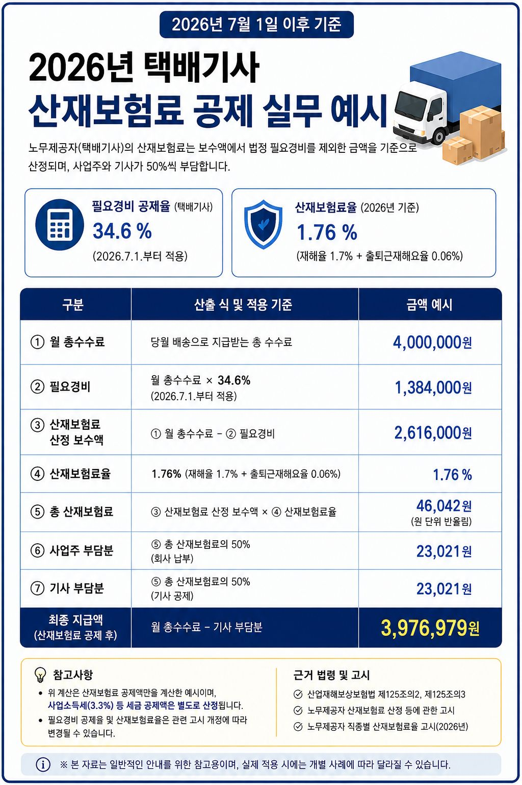

물류 및 운수 현장에서 화물차주나 택배기사와 위탁 계약을 맺고 계신 인사·총무 담당자라면 매번 달라지는 고용·산재 이슈로 머리가 복잡하실 겁니다.

특히 과거와 달리 제도가 대폭 개편되면서 "취득·상실신고는 안 해도 된다는데 산재보험료는 왜 매달 나가고 있지?" 하며 혼란스러워하시는 실무자분들이 많습니다.

오늘은 현업 담당자들이 가장 헷갈려하시는 노무제공자 산재보험 의무가입 및 산재보험료 산정 방법,

그리고 매월 운송료 정산 시 꼭 챙겨야 할 실무 포인트를 깔끔하게 정리해 드리겠습니다.

1. 산재보험 전속성 요건은 폐지되었지만, **'****의무가입'은 계속됩니다.**

과거에는 현장에 기사님이 들어오고 나갈 때마다 공단에 일일이 입·이직(취득·상실) 신고를 해야 했습니다.

하지만 2023년 7월 1일부터 산재보험 노무제공자에 대한 보험 적용·징수체계가 개편되면서,

월 보수액을 신고하고 이를 기준으로 보험료를 산정·부과하는 방식이 도입되었습니다.

✔ 어떻게 바뀌었나요?

기존의 자격관리 중심 방식에서 벗어나, 사업주가 노무제공자의 월 보수액을 신고하고 이를 기준으로 근로복지공단이 월별 산재보험료를 부과하는 방식으로 변경되었습니다.

신고의 번거로움은 사라졌으나, ‘산재보험 의무가입(전속성 폐지)’ 자체는 그대로 유지되고 있습니다.

따라서 화물차주나 택배기사를 단순 프리랜서로 여겨 산재보험을 누락할 경우, 추후 보험료가 추가로 부과될 수 있어 주의가 필요합니다.

2. 매월 운송료 정산 시 피할 수 없는 **'산재보험료 50:50 분담'**

산재보험료는 사업주와 노무제공자가 각각 50%씩 부담하는 것이 원칙입니다.

다만 법령에서 정하는 일부 직종은 사업주가 전액 부담하는 예외가 있으므로 적용 직종을 확인해야 합니다.

✔ 실무적으로는 어떻게 처리하나요?

회사가 매월 기사에게 운송료 등을 지급할 때 노무제공자 부담분을 지급 보수에서 공제하여 납부할 수 있으며,

사업주 부담분을 합산하여 산재보험료를 납부하게 됩니다. 이 경우 사업주는 노무제공자에게 산재보험료 공제계산서를 발급해야 합니다.

택배기사나 화물차운전자 등 노무제공자의 고용보험과 산재보험은 정확한 요건을 숙지하고, 보다 정확한 월 보수액 계산을 통해 보험료를 산정하는 것이 매우 중요합니다.

**노무법인 남산의 특고노무제공자 고용·산재 신고 업무대행을 활용하시면 정확한 고용·산재 가입기준에 따라 분류하여 체계적으로 관리하실 수 있고, **

**정확한 월 보수액 계산에 따른 보험료 산정 내역을 받아보실 수 있습니다. **

이 외에도 택배기사의 피보험자격에 따른 취득·상실 신고를 기한 내에 처리하여 과태료 및 벌금 등이 발생할 수 있는 리스크를 최소화 할 수 있습니다.

