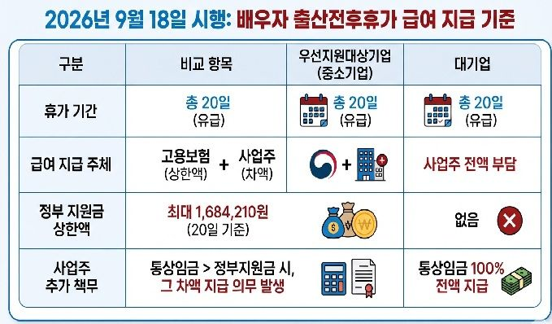
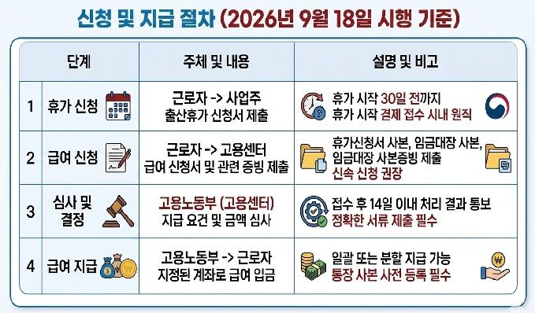

## 명칭과 사용 시기가 바뀝니다

2026년 9월 18일부터 '배우자 출산휴가'의 이름이 '배우자 출산전후휴가'로 바뀝니다.

가장 큰 변화는 쓸 수 있는 시기입니다. 지금까지는 출산한 날 이후에만 휴가를 시작할 수 있어 출산 전 돌봄이 어려웠지만, 개정법 시행 후에는 배우자의 출산예정일 50일 전부터 나눠 쓸 수 있습니다.

- **개정 전**: 배우자가 출산한 날 이후부터 사용
- **9월 18일 이후**: 출산예정일 50일 전부터 사용

## 휴가 기간과 급여

휴가는 모두 20일이고 전부 유급입니다. 고용보험에서 지원하는 배우자 출산휴가급여는 회사가 우선지원대상기업인지에 따라 지급 방식과 회사 부담분이 달라집니다.

예를 들어 우선지원대상기업에서 20일 기준 통상임금이 2,500,000원인 직원이라면 고용보험에서 상한액 1,684,210원이 나오고, 차액 815,790원은 회사가 유급으로 지급해야 합니다.

## 휴가 운영과 분할 사용

## 확인할 것

- 명칭 변경과 출산 전 50일 사용 가능 내용을 사내 규정에 반영했는지
- 우선지원대상기업이라면 고용보험 상한액(1,684,210원)을 넘는 직원의 차액 지급을 급여대장에 반영했는지
- 2026년 7월 1일부터 시행된 업무분담 지원금을 확인했는지. 배우자 출산휴가를 20일 연속으로 주고 동료에게 업무분담 수당을 지급하면 월 최대 40~60만 원을 지원받을 수 있습니다([업무분담 지원금 정리](/board/n036/)).
- 정당하게 청구한 휴가를 주지 않거나 무급으로 처리하면 500만 원 이하의 과태료 대상이라는 점을 현장 관리자에게 알렸는지

2026년 하반기에는 배우자 출산전후휴가 외에도 단기 육아휴직 신설, 육아기 근로시간 단축 거부사유 축소 등 일·가정 양립 제도가 한꺼번에 바뀝니다. 취업규칙 변경 신고나 급여 반영이 필요하시면 노무법인 남산으로 문의해 주십시오.

