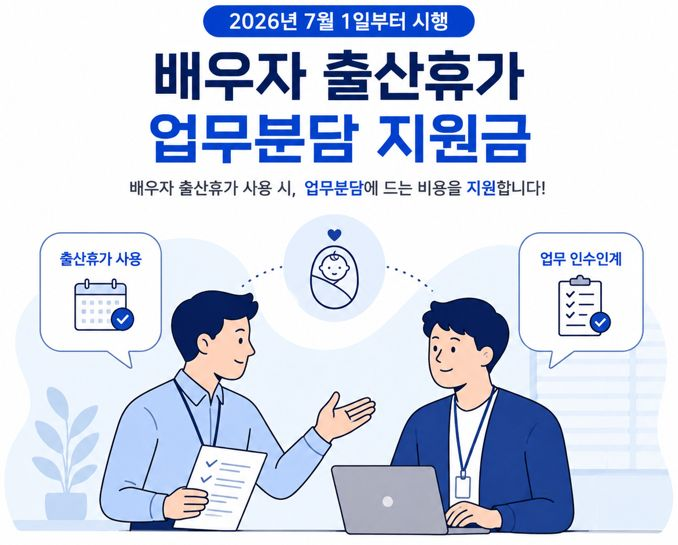
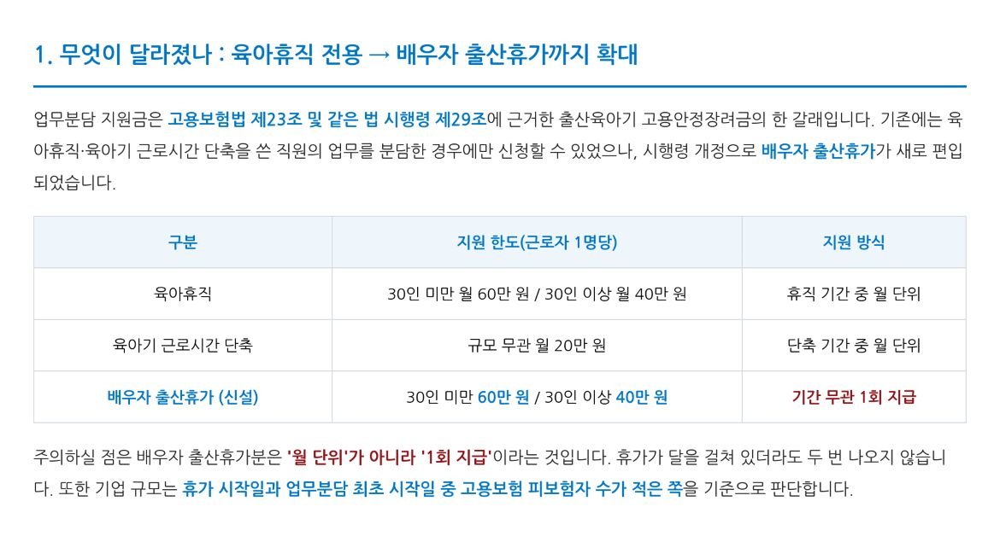
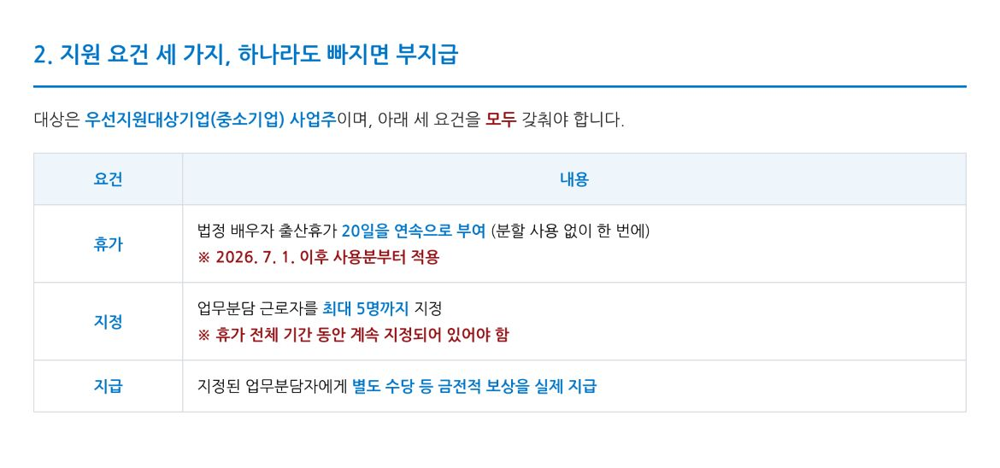
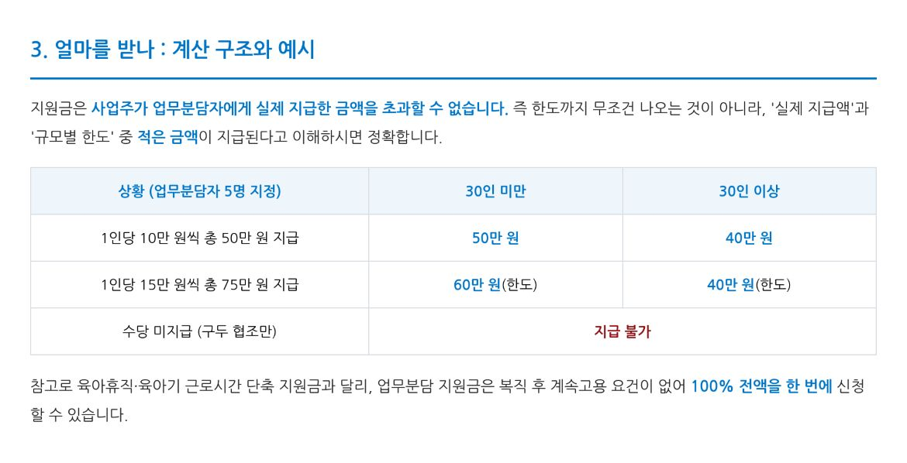
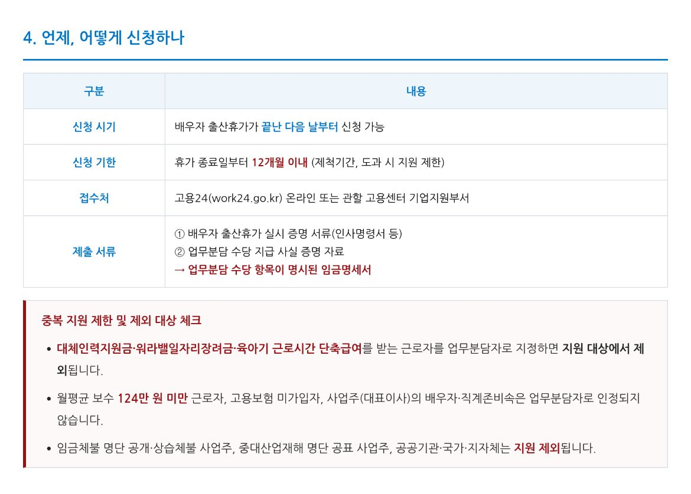
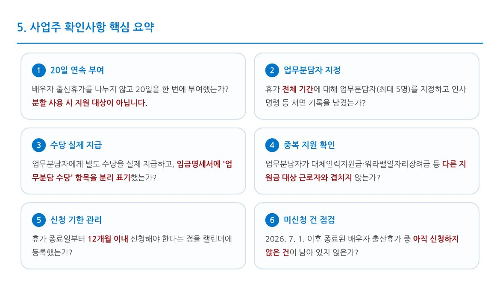
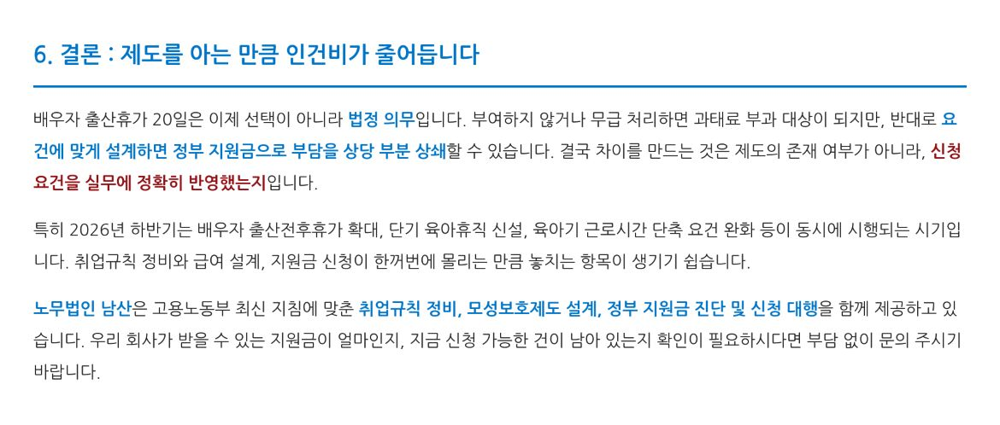

앞선 글에서 2026년 9월 18일부터 시행되는 [배우자 출산전후휴가](/board/n032/) 개정 내용을 정리했습니다. 명칭이 바뀌고, 출산 예정일 50일 전부터 쓸 수 있으며, 20일 모두 유급이라는 내용이었습니다.

글을 올린 뒤 인사 담당자분들께 가장 많이 받은 질문은 "20일을 통째로 비우면 그 일은 누가 하느냐"였습니다.

정부도 같은 고민을 했습니다. 2026년 7월 1일부터 육아휴직에만 있던 업무분담 지원금을 배우자 출산휴가까지 넓혔습니다. 휴가자의 일을 나눠 맡은 동료에게 회사가 수당을 주면, 그 금액을 정부가 최대 60만 원까지 보전해 주는 제도입니다.

