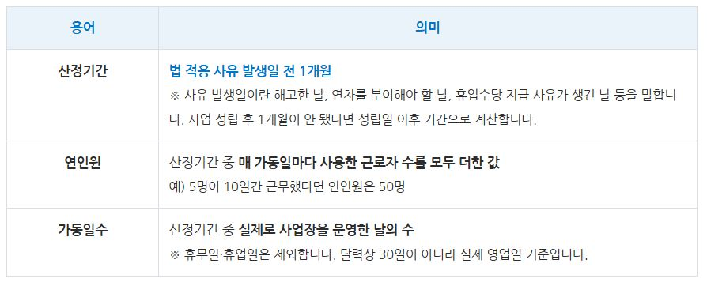
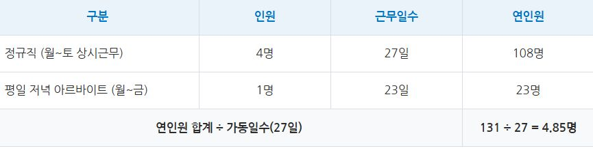
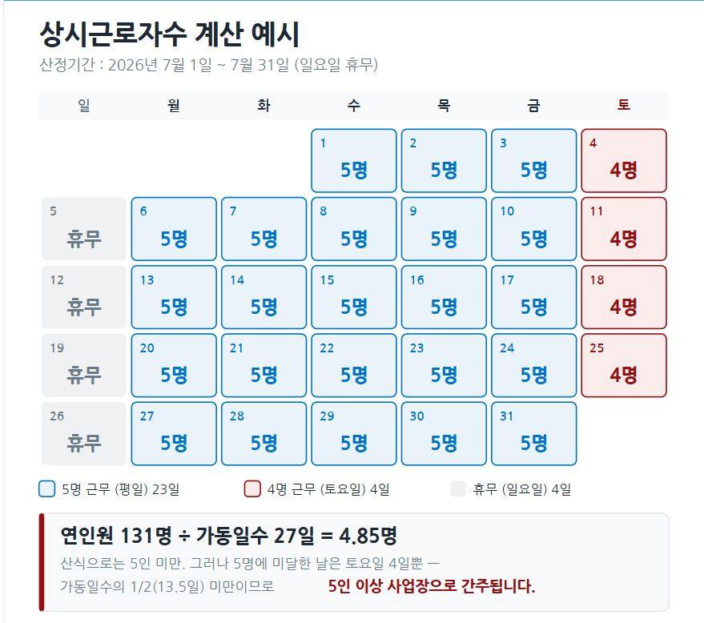
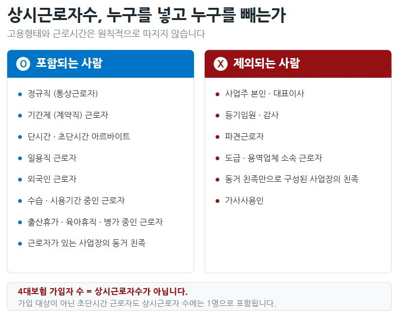
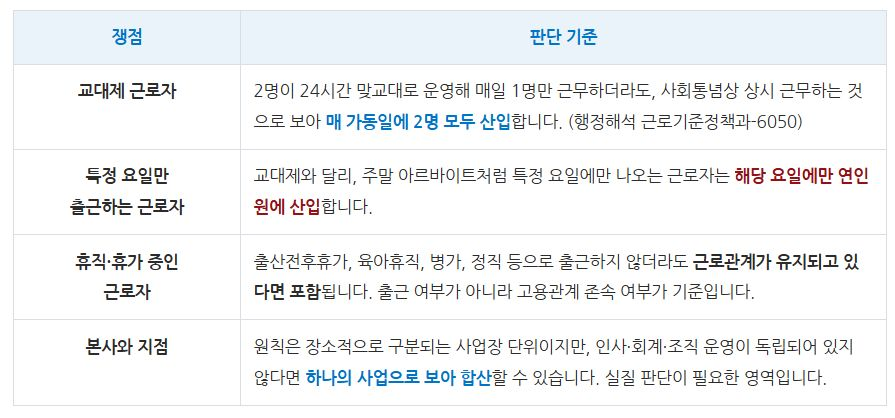
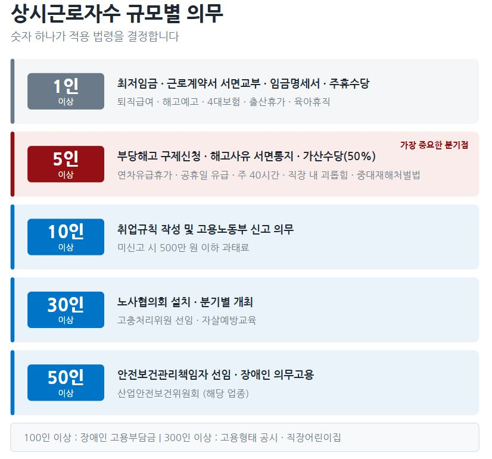

인사노무 실무에서 가장 먼저 확인해야 할 숫자가 상시근로자 수입니다. 연차휴가, 가산수당, 부당해고 구제신청, 취업규칙, 중대재해처벌법까지 대부분의 노동법 적용 여부가 이 숫자로 갈립니다.

그런데 현장에서는 "우리 직원이 몇 명이더라" 하는 감으로 판단하는 경우가 많습니다. 법이 정한 계산 방법은 이와 다릅니다.

## 산정 공식

근거는 근로기준법 시행령 제7조의2입니다.

> 상시근로자 수 = 산정기간 동안 사용한 근로자 연인원 ÷ 산정기간 중 가동일수

산정기간은 법 적용 사유가 생긴 날 전 1개월입니다.

예를 들어 2026년 8월 1일 해고가 있었던 음식점이라면 산정기간은 7월 1일부터 31일까지이고, 일요일은 휴무입니다.

계산하면 4.85명으로 5인 미만이 나옵니다. 그런데 이 사업장은 5인 이상 사업장으로 판단됩니다. 이유는 다음 규칙 때문입니다.

## 2분의 1 규칙

시행령 제7조의2 제2항은 산식 결과만으로 판단하지 않도록 보정 규칙을 두고 있습니다. 실무에서 결론이 뒤집히는 경우가 대부분 여기서 나옵니다.

앞의 예시에서 가동일 27일 가운데 근로자가 5명이었던 날은 평일 23일, 4명이었던 날은 토요일 4일입니다. 5명에 못 미친 날(4일)이 가동일수의 절반(13.5일)보다 훨씬 적으므로, 평균이 4.85명이어도 5인 이상 사업장이 됩니다.

근무일이나 인원 배치를 조정해 평균만 5명 아래로 맞추는 경우도 있는데, 이 규칙이 바로 그런 조정을 막기 위한 것입니다. 날짜별 인원을 확인하면 결론이 그대로인 경우가 대부분이고, 분쟁이 생기면 오히려 법 적용을 피하려 했다는 의심을 받을 수 있습니다.

## 누구를 넣고 누구를 빼나

산식보다 분쟁이 더 잦은 부분입니다. 원칙적으로 고용형태는 따지지 않습니다.

자주 하는 오해가 두 가지 있습니다.

- **"주 15시간 미만 초단시간 근로자는 빠지지 않나요?"** 아닙니다. 초단시간 근로자는 주휴수당·연차·퇴직금에서는 제외될 수 있지만 상시근로자 수에는 1명으로 들어갑니다. 하루 2시간만 일해도 그날 연인원에 1명으로 잡힙니다.
- **"4대보험 가입자 수를 보면 되지 않나요?"** 아닙니다. 보험 가입 인원과 상시근로자 수는 다른 개념입니다. 초단시간 근로자처럼 보험 가입 대상이 아닌 사람도 상시근로자 수에는 들어갑니다. 판단 자료는 실제 근무표, 출근부, 급여대장입니다.

## 결론이 갈리는 쟁점

**연차휴가는 기준이 다릅니다.** 시행령 제7조의2 제3항에 따라 연차휴가(근로기준법 제60조~제62조) 적용 여부는 월 단위로 계산해 사유 발생일 전 1년 동안 계속 5명 이상이어야 합니다. 최근 한 달만 5인 이상이라고 바로 15일 연차가 생기지는 않습니다. 다만 입사 1년 미만자의 월 1일 연차(제60조 제2항)는 이 규정에서 빠지므로 일반 산식으로 판단합니다.

## 인원 규모별 의무

5명 말고도 인원 구간마다 생기는 의무가 다릅니다.

중대재해처벌법은 2024년 1월 27일부터 상시근로자 50명 미만 사업장(건설업은 공사금액 50억 원 미만)에도 적용되어, 지금은 5인 이상 사업장 모두가 대상입니다.

## 5인 미만 사업장 적용 확대 논의

정부는 5인 미만 사업장에 근로기준법을 넓혀 적용하는 방안을 추진하고 있고, 고용노동부가 기초 조사를 시작했으며 경제사회노동위원회에서 노사 논의가 진행 중입니다. 다만 적용 범위와 시행 시기는 아직 정해지지 않았습니다.

지금 4~5인을 오가는 사업장이라면 법 개정과 관계없이, 5인 이상이 되는 순간부터 연차·가산수당·해고 제한이 바로 적용된다는 점부터 확인해 두셔야 합니다.

## 점검해 볼 것

- 상시근로자 수를 4대보험 가입자 수로 판단하고 있지 않은지
- 연인원 ÷ 가동일수로 실제 계산해 본 적이 있는지
- 산식 결과가 5인 미만이어도 2분의 1 규칙을 적용해 봤는지
- 주말·단시간 아르바이트생을 빼고 계산하고 있지 않은지
- 육아휴직·병가 중인 직원을 빼고 계산하고 있지 않은지
- 교대 근무자를 그날 출근한 인원만 세고 있지 않은지
- 본사·지점·매장이 하나의 사업으로 합쳐질 여지는 없는지
- 5인 이상이라면 연차·가산수당·해고 절차를 실제로 지키고 있는지
- 10인 이상이라면 취업규칙을 신고했는지(변경 시 재신고 포함)
- 근무표·출근부·급여대장 등 인원을 증명할 자료를 보관하고 있는지

아르바이트 비중이 높거나, 교대제로 운영하거나, 매장이 여러 곳인 사업장은 스스로 계산한 결과와 노동위원회·근로감독의 판단이 다른 경우가 많습니다. 사건이 접수된 뒤에는 근무표와 급여자료가 그대로 증거가 되므로 미리 점검해 두는 것이 중요합니다.

