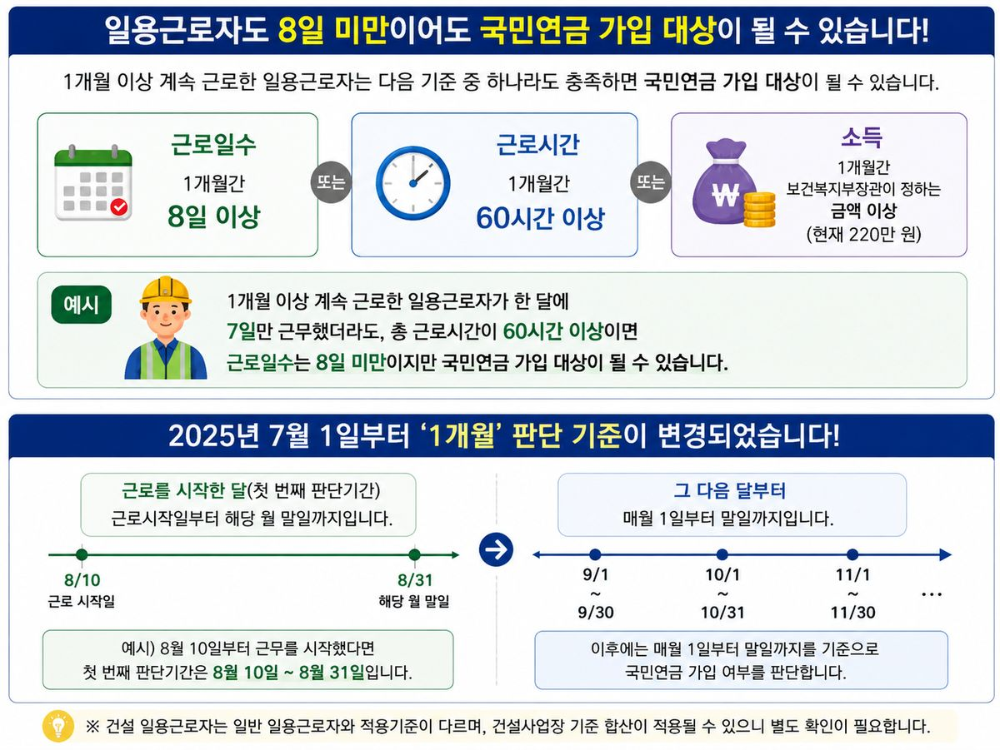

단기 인력을 쓰는 사업장에서 가장 자주 받는 질문이 "일용직은 4대보험 안 들어도 되죠?"입니다.

결론부터 말씀드리면 일용근로자라고 4대보험이 일괄 면제되지는 않습니다. 보험마다 기준이 다르고, 흔히 알려진 "월 8일 미만이면 전부 제외"는 사실이 아닙니다. 특히 건설일용직은 합산 기준이 적용되므로 따로 확인해야 합니다.

## 국민연금

일용근로자가 1개월 이상 계속 일하면서 다음 중 하나에 해당하면 사업장가입자가 됩니다.

- 월 8일 이상 근로
- 월 60시간 이상 근로
- 월 소득이 보건복지부장관이 정한 금액(현재 220만 원) 이상

최근 바뀐 부분이 두 가지 있습니다.

- **역월 기준**: 근로를 시작한 날이 아니라 매월 1일부터 말일까지를 기준으로 그달의 근로일수와 소득을 봅니다.
- **건설일용직 합산**: 한 현장에서 8일 미만으로 일했더라도, 같은 건설사업주의 여러 현장에서 일한 날을 합쳐 월 8일 이상(또는 합산 소득 220만 원 이상)이면 사업장가입자가 됩니다.

## 건강보험

건강보험은 국민연금과 기준이 다릅니다. 고용관계와 소정근로시간을 보고 직장가입 여부를 판단하며, 원칙적으로 1개월 소정근로시간이 60시간 미만인 단시간근로자 등은 직장가입자에서 제외될 수 있습니다. 건설공사 사업장 등 일부는 별도 기준이 있습니다. 국민연금 기준을 건강보험에 그대로 적용하지 않도록 주의해야 합니다.

## 고용보험·산재보험

**고용보험**은 단시간근로자 적용 제외 기준과 달리 일용근로자에게는 적용됩니다. 하루나 며칠만 일했다고 대상에서 빠지지 않으므로 근로내용확인신고를 해야 합니다.

**산재보험**도 근무기간이 짧다는 이유로 제외되지 않습니다. 사업 종류와 법령상 적용제외 여부만 확인하면 됩니다.

## 신고 기한

일용근로자 근로내용확인신고는 일한 달의 다음 달 15일까지 합니다. 8월에 일했다면 9월 15일까지입니다. 매달 일용근로자가 생기는 사업장이라면 급여 마감할 때 근로일수와 근로내역을 같이 정리해 두면 기한을 놓치지 않습니다.

일용근로자 기준은 역월 기준이나 건설업 합산처럼 계속 바뀌고 있습니다. 근로자 요청이나 예전 기준대로 신고를 빠뜨리면 나중에 과태료와 소급 보험료로 돌아옵니다. 일용직 4대보험 신고나 급여 처리를 점검하고 싶으시면 노무법인 남산으로 문의해 주십시오.

