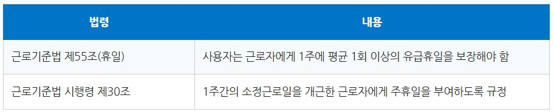
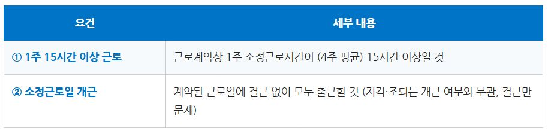
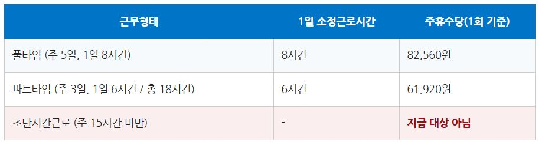
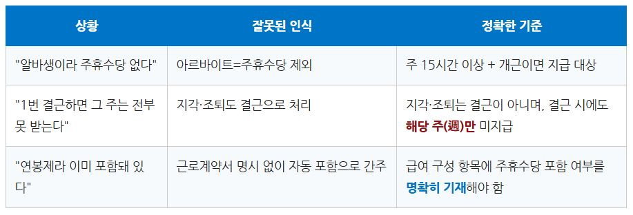
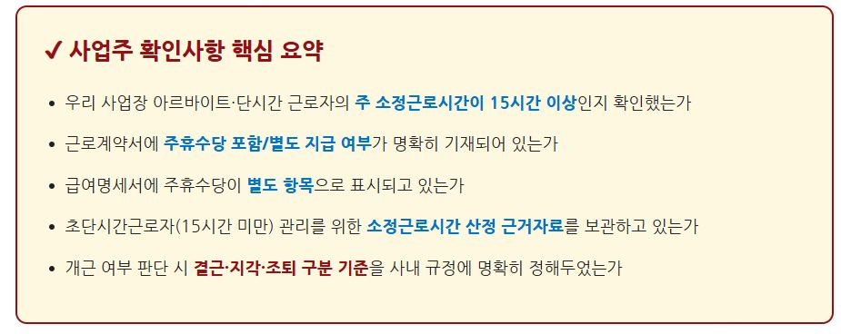

## 주휴수당이란

근로기준법 제55조에 따라 사용자는 근로자에게 1주에 평균 1회 이상 유급휴일을 주어야 합니다. 이 휴일에 대해 지급하는 임금이 주휴수당입니다. 상시근로자 수와 관계없이 5인 미만 사업장에도 똑같이 적용됩니다.

## 지급 요건

다음 두 가지를 모두 채우면 주휴수당이 발생합니다.

1주 소정근로시간이 15시간 미만인 초단시간근로자에게는 주휴수당을 주지 않아도 됩니다.

## 계산 방법

> 주휴수당 = 1일 소정근로시간 × 시급

2026년 최저시급 10,320원 기준으로 계산하면 다음과 같습니다.

## 사업주가 자주 하는 오해

## 주지 않으면

주휴수당을 주지 않으면 근로기준법 위반으로 2년 이하의 징역 또는 2천만 원 이하의 벌금에 처해질 수 있습니다. 근로자가 노동청에 진정을 내면 그 건만 보는 것이 아니라 사업장 전체 근로감독으로 번질 수도 있으므로 미리 점검해 두는 것이 좋습니다.

주휴수당은 단순해 보여도 근로시간 산정, 개근 여부 판단, 최저임금과 연동된 계산에서 다툼이 자주 생깁니다. 근로계약서와 급여체계 점검이 필요하시면 노무법인 남산으로 문의해 주십시오.

