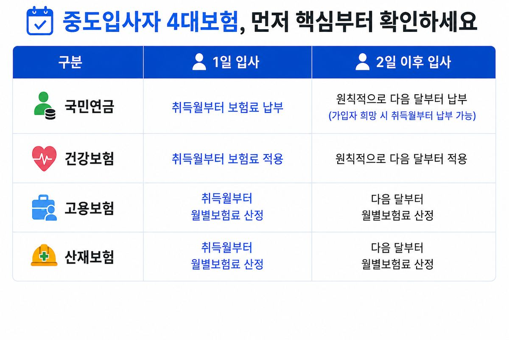

신규 입사자가 생기면 급여 계산과 함께 4대보험 취득신고와 보험료 처리를 해야 합니다. 그런데 직원이 월 중간에 입사하면 이런 질문이 생깁니다.

"10일에 입사했으면 보험료도 10일부터 일할 계산하면 되나요?"
"1일 입사자와 10일 입사자는 보험료가 다른가요?"

4대보험료는 보험마다 부과 기준이 따로 있어서 입사일 기준으로 일할 계산하면 안 됩니다. 특히 1일 입사인지 2일 이후 입사인지에 따라 보험료가 시작되는 달이 달라집니다. (2026년 기준)

## 급여와 보험료는 따로 봅니다

- **급여**: 회사의 급여 계산 기준에 따라 입사일부터 일할 계산
- **4대보험료**: 보험별 자격취득일과 부과 기준에 따라 처리

급여를 일할 계산했다고 보험료까지 일할 계산되는 것은 아닙니다.

## 국민연금

국민연금은 월 단위로 보험료를 냅니다.

- **1일 입사**: 8월 1일 입사 → 8월부터 납부
- **2일 이후 입사**: 8월 10일 입사 → 원칙적으로 9월부터 납부

다만 가입자가 원하면 2일 이후 입사자도 취득한 달부터 낼 수 있으므로, 취득신고할 때 본인 의사를 확인해 두는 것이 좋습니다.

## 건강보험

건강보험료도 자격을 취득한 달부터 부과하는 것이 원칙이지만, 매월 2일 이후에 취득했다면 다음 달부터 부과합니다.

- 8월 1일 입사 → 8월부터
- 8월 10일 입사 → 9월부터

## 고용보험·산재보험

고용보험과 산재보험은 월별보험료 방식으로 부과합니다. 고용보험료징수법에 따라 월 중간에 입사한 경우 다음 달부터, 1일에 입사한 경우 그 달부터 월별보험료를 산정합니다.

- 1일 입사 → 입사한 달부터
- 2일 이후 입사 → 다음 달부터

산재보험료는 사업주가 전액 부담하므로 근로자 급여에서 공제하지 않습니다.

중도입사자는 취득신고, 보수 신고, 급여 일할 계산까지 챙길 것이 많습니다. 작은 실수도 나중에 보험료 정산이나 과태료로 이어질 수 있으니 기준에 맞춰 처리해야 합니다.

