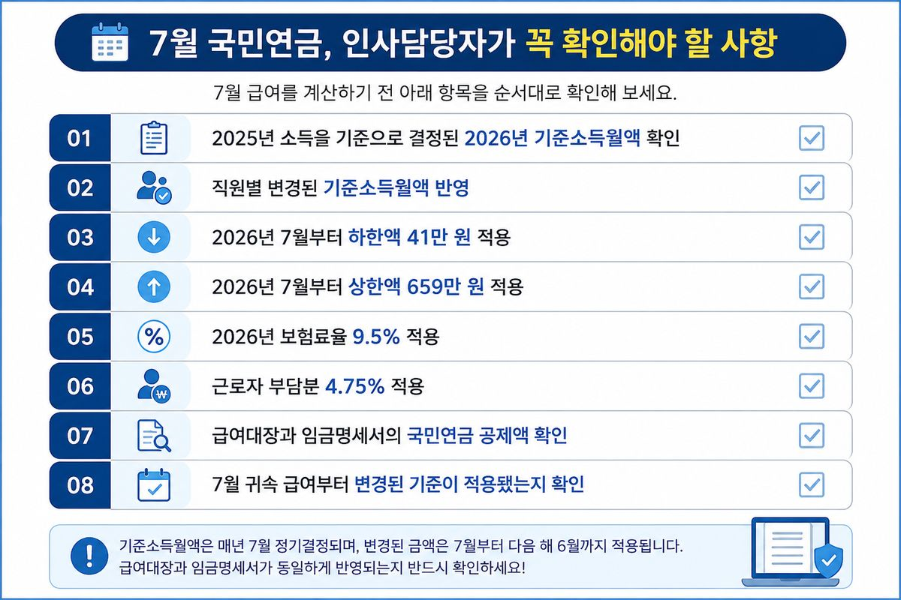

매년 7월 급여 담당자가 챙겨야 할 것이 국민연금 기준소득월액 정기결정입니다.

흔히 "7월부터 국민연금이 올랐다"고 생각하지만, 7월 변동의 원인은 보험료율이 아니라 전년도 소득을 반영해 새로 정해진 기준소득월액입니다.

## 7월에 보험료가 달라지는 이유

사업장가입자의 기준소득월액은 매달 급여에 따라 바뀌지 않습니다. 전년도에 그 사업장에서 받은 소득총액으로 기준소득월액을 정하고, 그 금액을 7월부터 다음 해 6월까지 적용합니다.

2026년이라면 2025년 소득으로 기준소득월액을 정해 2026년 7월부터 2027년 6월까지 적용합니다.

그래서 7월에 공제액이 바뀌었다면 먼저 직원별 기준소득월액이 바뀌었는지 확인해야 합니다. 전년도 소득이 늘었으면 보험료가 오르고, 줄었으면 내려갈 수도 있습니다. 모든 직원의 보험료가 일률적으로 오르는 것은 아닙니다.

## 직원별 기준소득월액부터 확인

국민연금 보험료는 기준소득월액 × 보험료율로 계산합니다. 예를 들어 기준소득월액이 300만 원이던 직원이 2026년에 330만 원으로 결정됐다면, 7월부터는 330만 원을 기준으로 보험료를 계산합니다.

지금 주는 월급만 보고 공제액을 판단하지 말고, 공단에서 결정된 기준소득월액을 먼저 확인해야 합니다.

## 상한액·하한액도 바뀝니다

2026년 7월부터 기준소득월액 하한액은 40만 원에서 41만 원으로, 상한액은 637만 원에서 659만 원으로 바뀌어 2027년 6월까지 적용됩니다.

이 금액이 모든 직원에게 적용되는 것은 아닙니다. 직원의 소득이 하한액보다 낮으면 하한액을, 상한액보다 높으면 상한액을 적용하는 구조입니다.

## 급여대장 반영 순서

급여대장의 국민연금 금액을 손으로 고치기보다는 바뀐 기준소득월액과 보험료율이 계산에 반영되도록 설정을 확인하는 것이 맞습니다.

1. **직원별 기준소득월액 확인**: 공단에서 결정한 금액을 확인합니다. 전년도 12월 2일 이후 입사자는 7월 정기결정 대상이 아니므로 취득 당시 기준소득월액이 계속 적용되는지 따로 확인합니다.
2. **7월 귀속 급여부터 반영**: 새 기준소득월액이 7월 귀속분부터 적용되도록 급여 프로그램이나 급여대장을 확인합니다.
3. **보험료율 확인**: 2026년 보험료율 9.5%가 적용되고 있는지 확인합니다.
4. **근로자 부담분 확인**: 근로자와 사업주가 절반씩 내므로 근로자 급여에서는 4.75%를 공제합니다.
5. **급여대장과 임금명세서 대조**: 급여대장의 공제액과 임금명세서 금액이 같은지 확인합니다.

국민연금뿐 아니라 건강보험, 고용보험, 산재보험도 기준과 요율이 수시로 바뀝니다. 남산PAY는 이런 변경 사항을 직원별로 확인해 매월 급여에 반영합니다.

