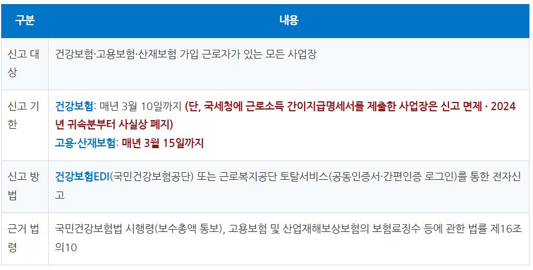
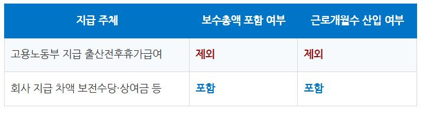
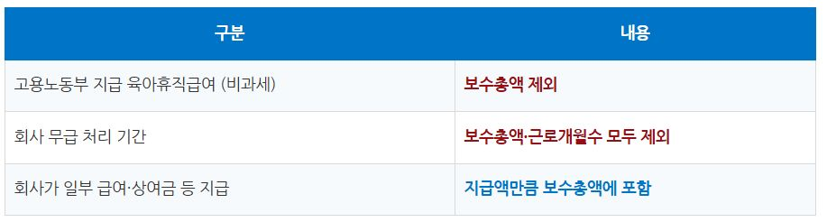
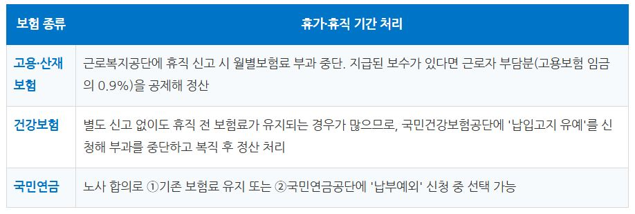
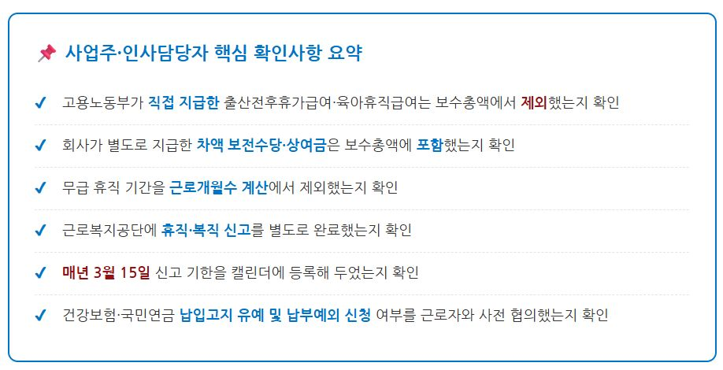

## 보수총액 신고란

4대보험 가입 사업장은 매년 전년도에 근로자에게 지급한 보수총액을 신고하고, 이를 바탕으로 건강보험료와 고용·산재보험료를 정산합니다. 출산휴가나 육아휴직을 쓴 직원이 있었다면 신고 방법을 정확히 알아 두어야 합니다.

건강보험 보수총액 통보는 국세청 근로소득 간이지급명세서 제출로 갈음되어, 대부분의 사업장은 간이지급명세서만 내면 따로 3월 10일 신고를 하지 않아도 됩니다. 하지만 고용·산재보험 보수총액신고는 지금도 사업장이 직접 해야 합니다. 둘을 혼동하지 않도록 주의하십시오.

## 출산전후휴가자

기준은 "누가 얼마를 줬느냐"입니다.

- **정부 지급분(출산전후휴가급여)**: 고용노동부가 근로자에게 직접 주는 출산전후휴가급여는 비과세 소득이므로 보수총액에서 뺍니다.
- **회사 지급분(차액 보전 등)**: 정부 지원금과 통상임금의 차액을 회사가 보전해 줬다면 그 금액은 과세 근로소득이므로 보수총액에 넣고, 해당 월은 근로개월수에도 포함합니다.

## 육아휴직자

원리는 같습니다. 회사가 급여를 전혀 주지 않은 무급 육아휴직이라면 그 기간은 보수총액과 근로개월수에서 모두 뺍니다. 회사가 급여 일부, 복지포인트, 상여금 등을 줬다면 그 금액만큼은 보수총액에 넣어야 합니다.

육아휴직급여는 2025년부터 크게 올라 첫 3개월은 통상임금의 100%(월 상한 250만 원)까지 나오지만, 고용노동부가 직접 지급하는 돈이므로 회사의 보수총액 신고와는 관계가 없습니다. 이 금액까지 보수총액에 넣는 실수가 가장 흔합니다.

## 보험별 처리

출산휴가·육아휴직 기간에는 보수총액 신고 외에도 보험별 절차를 함께 챙겨야 정산할 때 문제가 없습니다.

## 자주 하는 실수

1. **정부 지원금까지 보수총액에 포함**: 출산전후휴가급여와 육아휴직급여는 비과세이므로 신고 대상이 아닙니다.
2. **무급 기간을 근로개월수에 그대로 포함**: 급여를 주지 않은 달은 근로개월수에서 빼야 월평균보수가 맞게 나옵니다.
3. **휴직·복직 신고 없이 보수총액만 신고**: 근로복지공단에 휴직 신고를 하지 않으면 보험료가 제대로 줄지 않아 과오납이 생깁니다.

## 기한을 놓치면

- 300만 원 이하의 과태료
- 두루누리 사회보험료 지원 등 지원사업에서 제외
- 공단이 직권으로 산정한 보험료가 부과되어 오히려 더 많이 낼 수 있음

출산휴가자·육아휴직자 보수총액 신고는 근로자의 급여 처리와 회사의 보험료가 함께 걸린 일입니다. 급여 상한액과 제도가 해마다 조금씩 바뀌므로 신고 전에 한 번 더 확인하는 것이 안전합니다.

