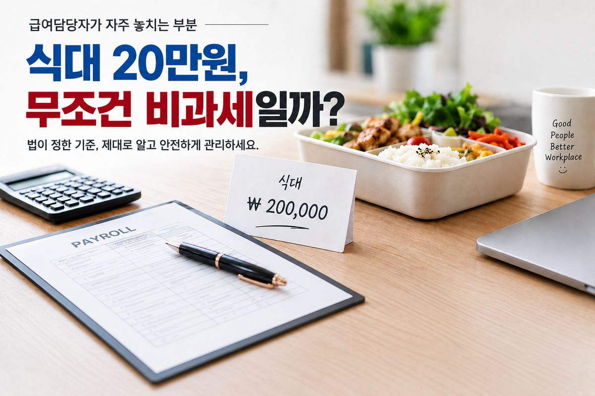

급여를 설계하거나 근로계약서를 쓸 때 거의 빠지지 않는 항목이 식대입니다. "식대는 월 20만 원까지 비과세"라는 말은 실무자라면 다 알지만, 이를 "20만 원 이하로만 주면 무조건 비과세"로 이해하면 문제가 생깁니다.

지급 방식이나 다른 복리후생과 겹치는지에 따라 비과세가 안 될 수 있고, 통상임금 계산에까지 영향을 줄 수 있습니다.

## 법적 근거와 한도

식대 비과세는 소득세법 제12조 제3호와 시행령에 근거합니다. 한도는 월 10만 원이었다가 2023년 1월 1일부터 월 20만 원으로 올랐습니다.

20만 원은 요건을 갖췄을 때 비과세를 받을 수 있는 한도이지, 무조건 인정되는 금액이 아닙니다. 요건을 갖추지 못하면 20만 원 이하라도 전액 과세됩니다.

## 비과세가 되려면

**식사를 따로 제공받지 않아야 합니다**
회사가 구내식당이나 도시락처럼 식사를 이미 제공하고 있다면, 따로 주는 현금 식대는 비과세가 아니라 전액 과세 대상입니다. 식사도 주고 식대도 주는 구조는 비과세 취지에 맞지 않기 때문입니다.

**지급 기준을 규정에 적어 두는 것이 좋습니다**
식대의 지급 기준과 금액은 근로계약서, 취업규칙, 급여규정에 분명히 정해 두는 것이 바람직합니다. 세법상 요건과는 별개이지만, 노동법상 임금인지, 통상임금인지를 판단할 때 근거가 됩니다.

## 20만 원을 넘으면

넘는 부분만 과세됩니다. 25만 원을 줬다면 20만 원은 비과세, 5만 원은 과세 근로소득으로 처리합니다. 4대보험 보수에 넣을지는 보험별 기준에 따라 따로 확인해야 합니다. 급여 프로그램에서 초과분을 과세 항목으로 나누지 않고 전액 비과세로 처리해 두는 실수가 종종 있으니 급여대장에서 확인해 보시기 바랍니다.

## 비과세라고 통상임금에서 빠지는 것은 아닙니다

"식대는 비과세니까 통상임금에도 안 들어간다"고 생각하는 경우가 많습니다. 하지만 비과세 여부는 세법 문제이고, 통상임금 해당 여부는 근로기준법 문제입니다.

대법원은 2024년 12월 19일 전원합의체 판결로 통상임금 판단 기준에서 '고정성'을 빼고 소정근로의 대가성, 정기성, 일률성을 중심으로 판단하도록 기준을 바꿨습니다. 매월 모든 직원에게 정기적·일률적으로 주는 식대라면 비과세 항목이라도 통상임금에 들어가 연장·야간·휴일수당과 퇴직금 계산에 영향을 줄 수 있습니다.

실무에서 자주 빠뜨리는 부분도 있습니다.

- 현장직·재택근무자 등 근무 형태별로 식대 기준이 다른 경우: 일률성 판단에 영향을 줄 수 있습니다.
- 근로계약서는 그대로 두고 식대 항목만 새로 만들거나 바꾼 경우: 규정과 실제 지급 내용이 맞는지 확인해야 합니다.
- 4대보험 보수월액에서 비과세 식대를 빠뜨리거나 두 번 처리한 경우: 보험료 정산 오류로 이어집니다.

통상임금 판단 기준이 바뀐 만큼, 예전 급여 규정을 그대로 쓰고 있는 사업장이라면 식대 지급 방식을 한 번 점검해 보시기 바랍니다.

