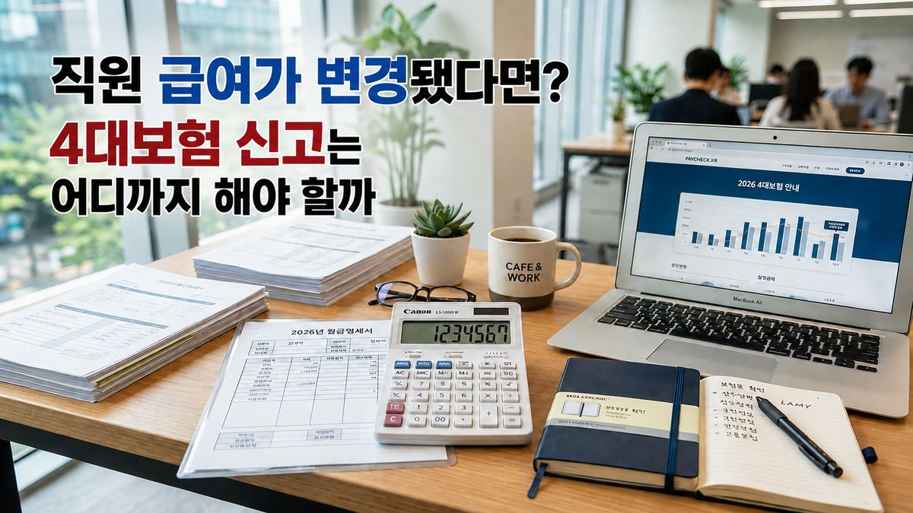

직원 연봉이 오르거나 기본급·수당이 바뀌면 급여 담당자는 이런 고민을 하게 됩니다.

"급여가 올랐는데 4대보험도 전부 변경해야 하나?"
"국민연금도 오른 달부터 바로 바꿔야 하나?"
"수당이 새로 생겼는데 신고도 해야 하나?"

결론부터 말씀드리면, 급여가 바뀌었다고 4대보험을 모두 같은 방식으로 바꾸지는 않습니다. 보험마다 보수 기준과 변경 절차가 다르기 때문입니다. 2026년 하반기에는 국민연금 기준소득월액 상·하한액도 바뀌었으니 함께 확인하는 것이 좋습니다.

## 사례

A회사 직원의 월급이 2026년 8월부터 연봉 인상으로 300만 원에서 350만 원으로 올랐습니다. 담당자는 8월 급여대장에 반영한 뒤 "50만 원이 올랐으니 4대보험도 다 변경신고해야 하지 않나?"라는 생각이 들었습니다.

이 경우 보험별로 따로 판단해야 합니다. 먼저 어떤 급여 항목이 바뀌었는지 확인하고, 그 항목이 각 보험의 보수에 들어가는지, 변경신청이 필요한지, 보험료가 언제부터 바뀌는지를 차례로 본 뒤 급여대장과 임금명세서에 반영합니다.

| 보험 | 기준 | 급여가 바뀌었을 때 |
| --- | --- | --- |
| 국민연금 | 기준소득월액 | 변경신청 요건에 해당하는지 확인 |
| 건강보험 | 보수월액 | 변경신청 대상인지 확인 |
| 고용보험 | 월평균보수 | 변경신고 대상인지 확인 |
| 산재보험 | 월평균보수 | 변경신고 대상인지 확인 |

## 국민연금: 올랐다고 바로 바꾸지 않습니다

국민연금은 전년도 소득으로 정한 기준소득월액을 1년 동안 적용합니다. 그래서 월급이 바뀌었다고 그달부터 바로 바뀐 금액을 적용하지 않습니다.

다만 사업장가입자의 소득이 전년도보다 20% 이상 오르거나 내린 경우에는 근로자의 동의를 받아 기준소득월액 변경을 신청할 수 있습니다. 신청하면 신청한 달의 다음 달부터 바뀐 기준소득월액이 적용됩니다. "8월에 올랐으니 8월 국민연금도 바로 바꾼다"는 식으로 처리하면 안 됩니다.

## 건강보험: 100인 이상 사업장은 변경신청이 의무입니다

건강보험은 보수월액을 기준으로 보험료를 계산합니다. 기본급 인상, 매월 주는 고정수당 신설, 기존 수당 금액 변경 등이 있었다면 그 항목이 건강보험 보수에 들어가는지 확인해야 합니다.

국민건강보험법 시행령 제36조 제1항에 따라 상시 100명 이상을 고용한 사업장은 보수가 바뀌면 보수월액 변경신청을 해야 합니다. 변경일이 그달 14일 이전이면 그달 15일까지, 15일 이후면 다음 달 15일까지 신청합니다. 100인 미만 사업장은 원칙적으로 선택이지만, 보수 변동이 크다면 다음 해 정산 부담을 줄이기 위해 신청을 검토해 볼 만합니다.

## 고용·산재보험: 월평균보수 변경신고

고용보험과 산재보험은 월평균보수를 기준으로 봅니다. 보수가 오르거나 내렸다면 고용보험료징수법 시행령에 따라 바뀐 월평균보수를 신고할 수 있습니다. 연중에 신고하지 않았다면 다음 해 보수총액신고 때 실제 보수로 정산되므로 그때는 반드시 챙겨야 합니다.

## 담당자가 놓치기 쉬운 부분

급여가 바뀌면 근로계약서 수정, 급여대장 수정, 임금명세서 반영까지는 대부분 챙깁니다. 그다음 4대보험 처리를 놓치는 경우가 많습니다.

- 기본급이 바뀌었는지, 새 수당이 생겼는지, 기존 수당 금액이 바뀌었는지
- 일회성 지급인지 정기 지급인지
- 그 항목이 보험별 보수에 들어가는지
- 국민연금 기준소득월액 변경신청 요건(20% 이상 변동)에 해당하는지
- 건강보험 보수월액 변경신청 대상인지(100인 이상은 의무)
- 고용·산재보험 월평균보수 변경신고 대상인지
- 바뀐 보험료가 급여와 임금명세서에 맞게 반영됐는지

이 내용은 2026년 8월 기준 관련 법령을 바탕으로 한 일반적인 안내입니다. 세부 기준은 사업장 상황에 따라 다를 수 있으니 실제 신고 전에 공단에 확인하시기 바랍니다. 급여 변경이 잦은 사업장이라면 남산PAY가 보험별 신고 대상 판단부터 신고, 보수총액 정산까지 함께 처리합니다.

