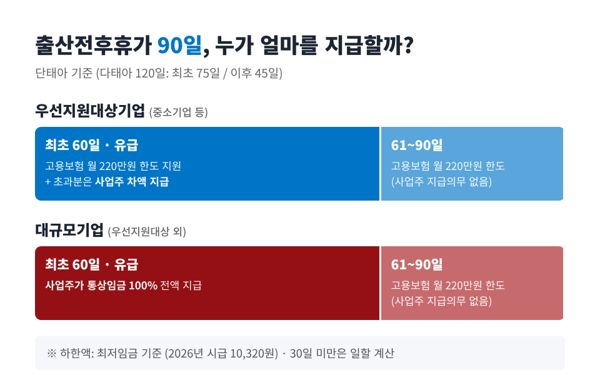
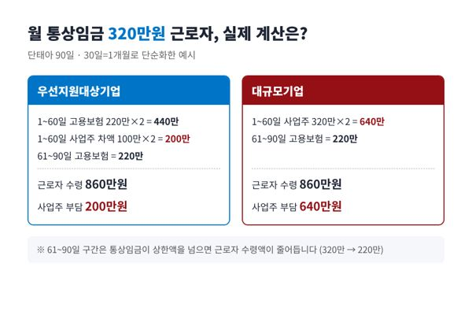
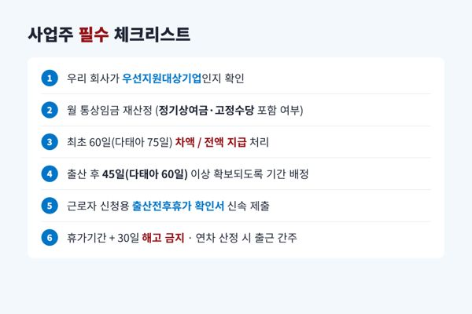

"출산휴가 급여는 고용보험에서 다 나오는 거 아닌가요?" 인사 담당자에게서 자주 받는 질문입니다. 그렇게 알고 있다가 임금체불이 되는 경우가 적지 않습니다.

상시근로자 80명인 제조업체 김 과장은 박 대리(월 통상임금 320만 원)의 출산전후휴가 신청을 받았습니다. "중소기업은 고용보험에서 90일 급여가 다 나온다"고 들어 휴가 기간에 회사는 급여를 주지 않았습니다. 그런데 복귀한 박 대리가 "고용보험에서 월 220만 원만 받았는데 나머지는 어떻게 되나요?"라고 물었습니다. 회사는 최초 60일 동안 통상임금과 고용보험 급여의 차액(약 200만 원)을 지급했어야 했고, 주지 않으면 임금체불입니다.

## 출산전후휴가 기본 구조

근로기준법 제74조에 따라 임신한 여성 근로자에게 출산 전후를 통틀어 90일(다태아 120일)의 휴가를 줘야 하고, 출산 후에 45일(다태아 60일) 이상이 남도록 배정해야 합니다.

| 구분 | 휴가 기간 | 출산 후 최소 기간 | 유급 기간 |
| --- | --- | --- | --- |
| 단태아 | 90일 | 45일 이상 | 최초 60일 |
| 다태아 | 120일 | 60일 이상 | 최초 75일 |
| 미숙아 출산 | 100일 | 45일 이상 | 최초 60일 |

최초 60일(다태아 75일)은 유급입니다(제74조 제4항). 다만 고용보험에서 출산전후휴가 급여가 나오면 그 금액만큼 회사의 지급 책임이 줄어듭니다. 그래서 '차액' 문제가 생깁니다.

## 기업 규모별로 누가 얼마를 주나

먼저 우리 회사가 우선지원대상기업인지 대규모기업인지 확인해야 합니다(고용보험법 제76조).

| 구분 | 최초 60일(다태아 75일) | 나머지 30일(다태아 45일) |
| --- | --- | --- |
| 우선지원대상기업 | 고용보험 지원(월 220만 원 한도) + 통상임금과의 차액은 회사 지급 | 고용보험 지원(월 220만 원 한도), 회사 지급 의무 없음 |
| 대규모기업 | 회사가 통상임금 100% 지급 | 고용보험 지원(월 220만 원 한도), 회사 지급 의무 없음 |

우선지원대상기업은 고용보험법 시행령 제12조에 따라 업종별 상시근로자 수 기준 이하인 기업입니다(제조업 500명 이하, 광업·건설업·운수창고업·정보통신업 등 300명 이하, 도소매업·숙박음식업 등 200명 이하, 그 밖의 업종 100명 이하). 기준을 넘더라도 중소기업기본법상 중소기업이면 해당될 수 있으니 따로 확인하십시오.

## 2026년 상한액과 하한액

- **상한액**: 월(30일) 220만 원. 2025년 210만 원에서 10만 원 올랐습니다.
- **하한액**: 최저임금(2026년 시급 10,320원, 주 40시간 기준 월 2,156,880원)
- **기준**: 휴가 시작일 기준 통상임금, 30일 미만은 일할 계산

고용보험 급여는 통상임금 100%를 주되 월 220만 원을 넘을 수 없고, 통상임금이 최저임금보다 낮으면 최저임금액으로 줍니다(고용보험법 시행령 제101조).

## 계산 예시

**1. 월 통상임금 확정**
기본급만 넣는 실수가 많습니다. 정기적·일률적으로 주는 직책수당, 자격수당, 정기상여금도 들어갈 수 있습니다. 2024년 12월 대법원 전원합의체 판결(2020다247190 등)로 '고정성' 요건이 빠지면서 재직조건이 붙은 정기상여금도 통상임금에 들어갈 수 있게 됐습니다. 그만큼 회사가 부담하는 최초 60일 차액도 커질 수 있으니, 판결 뒤 통상임금을 다시 계산하지 않았다면 꼭 점검하십시오.

**2. 구간별 계산**
월 통상임금 320만 원, 단태아 90일 기준입니다(30일을 1개월로 단순화).

| 구간 | 우선지원대상기업 | 대규모기업 |
| --- | --- | --- |
| 1~30일 | 고용보험 220만 원 + 회사 100만 원 | 회사 320만 원 |
| 31~60일 | 고용보험 220만 원 + 회사 100만 원 | 회사 320만 원 |
| 61~90일 | 고용보험 220만 원 | 고용보험 220만 원 |
| 근로자 수령 합계 | 860만 원 | 860만 원 |
| 회사 부담 합계 | 200만 원 | 640만 원 |

**3. 통상임금별 비교(단태아 90일, 우선지원대상기업)**

| 월 통상임금 | 고용보험(90일) | 회사 차액(60일) | 근로자 수령 합계 |
| --- | --- | --- | --- |
| 2,156,880원(최저임금) | 약 647만 원 | 0원 | 약 647만 원 |
| 250만 원 | 660만 원 | 60만 원 | 720만 원 |
| 320만 원 | 660만 원 | 200만 원 | 860만 원 |
| 400만 원 | 660만 원 | 360만 원 | 1,020만 원 |

실제 지급액은 휴가 시작일과 종료일에 따른 일할 계산, 통상임금 산정 방식에 따라 달라질 수 있습니다.

**4. 다태아인 경우**
휴가는 120일, 회사 유급 구간은 최초 75일로 늘어납니다. 대규모기업은 75일분 통상임금 전액을, 우선지원대상기업은 75일분 차액을 부담합니다.

## 신청 절차와 놓치기 쉬운 부분

- **지급 요건**: 휴가 종료일 이전 피보험단위기간 180일 이상(고용보험법 제75조)
- **신청**: 근로자 본인이 고용24 또는 관할 고용센터에 신청
- **회사가 할 일**: 출산전후휴가 확인서 제출, 임금대장 등 통상임금 확인 자료 준비
- **신청 기한**: 휴가 끝난 날부터 12개월 이내(지나면 받을 수 없음)
- **세금**: 고용보험 급여는 비과세, 회사가 주는 차액은 근로소득으로 과세

함께 지켜야 할 의무도 있습니다. 출산전후휴가 기간과 그 뒤 30일 동안은 해고할 수 없고(근로기준법 제23조 제2항), 휴가 기간은 연차 계산 때 출근한 것으로 봅니다(제60조 제6항). 휴가가 끝나면 휴가 전과 같은 업무나 같은 수준의 임금을 받는 직무로 복귀시켜야 하고(제74조 제6항), 휴가를 주지 않거나 유급분을 주지 않으면 형사처벌 대상입니다(제110조).

## 확인할 것

1. 우리 회사가 우선지원대상기업인지 대규모기업인지
2. 통상임금에 정기상여금·고정수당이 빠짐없이 들어갔는지
3. 최초 60일(다태아 75일)분 차액 또는 전액을 급여일에 지급했는지
4. 출산 후 45일(다태아 60일) 이상이 남도록 휴가를 배정했는지
5. 출산전후휴가 확인서를 제출했는지
6. 해고 금지, 연차 출근 간주, 같은 직무 복귀를 지키고 있는지

출산전후휴가 급여는 기업 규모 구분, 통상임금 산정, 일할 계산, 회사 차액 지급 가운데 하나만 놓쳐도 임금체불이 됩니다. 남산PAY는 휴가 기간 회사 부담액 계산과 급여 반영까지 함께 처리합니다.

