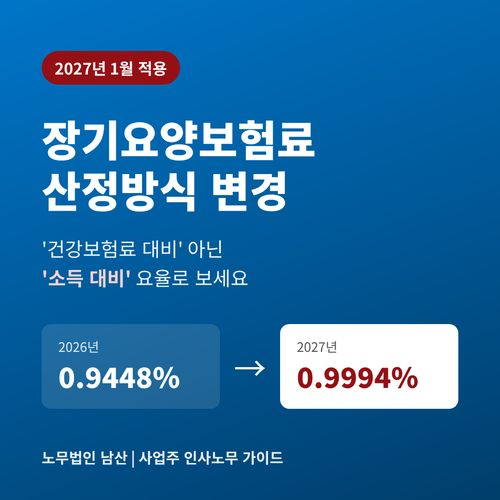
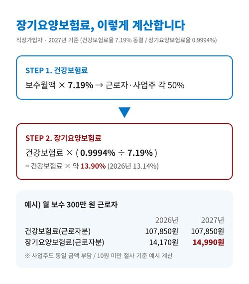

2026년 10월 30일 장기요양위원회에서 2027년 장기요양보험료율이 결정됐습니다. 건강보험료율은 7.19%로 동결됐지만, 장기요양보험료율은 0.9448%에서 0.9994%로 5.78% 오릅니다.

매년 "건강보험료는 그대로인데 왜 공제액이 바뀌었느냐"는 질문이 나옵니다. 장기요양보험료 계산 방식을 정확히 알면 바로 이해되는 부분입니다.

## 이런 일이 생깁니다

직원 80명 규모 제조업체 김 과장은 매년 1월 급여 프로그램에 새 보험료율을 넣습니다. 올해는 '건강보험료 동결' 기사만 보고 요율 변경을 건너뛰었습니다. 2월 초 공단 고지서를 받아 보니 장기요양보험료 고지액이 급여에서 공제한 금액보다 많았습니다. 결국 직원별로 추가 공제하거나 회사가 대신 부담해야 했고, 임금명세서도 다시 고쳐서 안내해야 했습니다. (실제 상담 유형을 바탕으로 재구성한 예시입니다.)

김 과장이 놓친 것은 장기요양보험료가 건강보험료에 고정된 비율을 곱하는 것이 아니라, 매년 정해지는 장기요양보험료율에 따라 그 비율 자체가 바뀐다는 점입니다.

## 계산 방식

장기요양보험료는 노인장기요양보험법 제8조에 따라 건강보험료와 함께 걷는 보험료입니다. 제9조는 계산 방식을 '건강보험료액 × (장기요양보험료율 ÷ 건강보험료율)'로 정하고 있습니다.

예전에는 요율을 '건강보험료의 ○○%'로 발표했지만, 2023년부터는 '소득(보수월액)의 ○○%'로 발표합니다. 건강보험료율과 같은 기준으로 비교할 수 있도록 표기를 바꾼 것입니다.

| 구분 | ~2022년 | 2023년~ |
| --- | --- | --- |
| 요율 기준 | 건강보험료 대비 비율 | 소득(보수월액) 대비 요율 |
| 표기 예시 | 건강보험료의 12.27%(2022년) | 소득의 0.9994%(2027년) |
| 실제 계산 | 건강보험료 × 고시 비율 | 건강보험료 × (장기요양보험료율 ÷ 건강보험료율) |

건강보험료율이 동결돼도 장기요양보험료율이 오르면 '건강보험료 대비 비율'도 함께 바뀝니다.

## 연도별 요율

| 연도 | 건강보험료율 | 장기요양보험료율(소득 대비) | 건강보험료 대비 비율 |
| --- | --- | --- | --- |
| 2026년 | 7.19% | 0.9448% | 13.14% |
| 2027년 | 7.19%(동결) | 0.9994% | 13.90% |

(출처: 보건복지부 장기요양위원회 의결 2026. 10. 30., 건강보험정책심의위원회 결정 2026. 9.) 세대당 월평균 장기요양보험료는 약 19,029원에서 20,129원으로 1,100원가량 늘어날 것으로 추정됩니다.

## 직원 공제액은 얼마나 바뀌나

직장가입자는 근로자와 사업주가 50%씩 부담합니다. 월 보수별 근로자 부담분은 다음과 같습니다.

| 월 보수 | 건강보험료(근로자분) | 장기요양 2026년 | 장기요양 2027년 | 월 증가액 |
| --- | --- | --- | --- | --- |
| 250만 원 | 89,870원 | 11,800원 | 12,490원 | +690원 |
| 300만 원 | 107,850원 | 14,170원 | 14,990원 | +820원 |
| 400만 원 | 143,800원 | 18,890원 | 19,980원 | +1,090원 |

10원 미만은 버린 예시입니다. 실제 금액은 공단 고지서 기준이며, 사업주 부담분도 같은 금액만큼 늘어납니다. 1인당 증가액은 크지 않지만 직원 100명 사업장이면 사업주 부담분만 1년에 100만 원 가까이 늘어나니 인건비 예산에 넣어 두십시오.

## 급여 담당자가 놓치기 쉬운 것

**급여 프로그램 요율 변경**
'건강보험료 동결'만 보고 장기요양보험료율 변경을 놓치는 경우가 가장 많습니다. 급여 프로그램이 '건강보험료 × 비율' 방식이면 13.14%를 13.90%로, '소득 × 요율' 방식이면 0.9448%를 0.9994%로 바꿔야 합니다.

**임금명세서 반영**
근로기준법 제48조 제2항에 따라 임금명세서에는 공제 항목별 금액을 적어야 합니다. 공제액이 바뀌었는데 명세서에 반영하지 않으면 과태료 대상이 될 수 있습니다.

**4월 정산**
매년 4월 건강보험 정산 때 장기요양보험료도 함께 정산됩니다. 보수 변동을 제때 신고하지 않으면 정산 금액이 커져 직원 불만이 생길 수 있습니다.

임금은 전액 지급이 원칙이고(근로기준법 제43조), 4대보험료처럼 법령에 근거한 공제만 예외입니다. 회사가 잘못 계산해 덜 공제한 보험료를 나중에 한꺼번에 공제할 때는 직원에게 미리 알리고 동의를 받는 것이 좋습니다.

## 확인할 것

| 확인 항목 | 시점 |
| --- | --- |
| 급여 프로그램에 장기요양보험료율 0.9994%(건강보험료 대비 13.90%) 반영 | 2027년 1월 급여 전 |
| 임금명세서 공제 항목·금액 확인 | 1월 급여 지급 시 |
| 1월분 공단 고지액과 실제 공제액 대조 | 2월 고지서 받은 뒤 |
| 사업주 부담 증가분을 2027년 인건비 예산에 반영 | 연초 예산 확정 전 |
| 보수 변경 신고 누락자 점검(4월 정산 대비) | 수시 |

장기요양보험료는 금액이 작아 소홀하기 쉽지만 매년 요율이 바뀌고 건강보험료율과 따로 움직여 공제 오류가 자주 생깁니다. 남산PAY는 매년 바뀌는 요율을 1월 급여부터 반영해 공제합니다.

