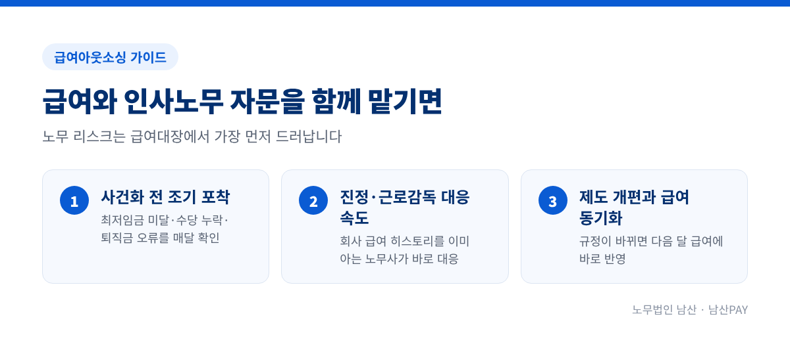

기업의 인사노무 리스크는 취업규칙 서랍 속이 아니라 <strong>매달 발행되는 급여대장에서 가장 먼저 드러납니다.</strong> 급여아웃소싱과 인사노무 자문을 같은 노무법인에 맡기면, 잠재된 노무 문제가 노동청 진정이나 근로감독 같은 '사건'으로 번지기 전에 조기에 차단할 수 있습니다.

### 급여와 노무 자문을 원스톱으로 묶을 때 생기는 3가지 변화

1. <strong>사건화 전 리스크의 조기 포착</strong>  
   최저임금 미달 위험, 연장근로수당 누락, 퇴직금 평균임금 산정 오류 등은 매달 급여를 계산하는 과정에서 즉각 눈에 띕니다. 급여를 직접 보는 노무사가 즉시 경고를 보내고 시정 방안을 제시하므로 리스크가 누적되지 않습니다.
2. <strong>노동청 진정·근로감독 시 압도적인 대응 속도</strong>  
   갑자기 퇴사자 진정이나 노동청 근로감독 통지를 받았을 때, 외부 노무사를 새로 선임하면 회사의 임금체계와 급여대장을 파악하는 데만 며칠이 걸립니다. 평소 급여를 관리하던 노무법인이라면 모든 히스토리를 이미 알고 있는 상태에서 지체 없이 대응할 수 있습니다.
3. <strong>인사 제도 개편과 급여의 완벽한 동기화</strong>  
   임금규정이나 취업규칙, 연봉계약서 양식을 개정했을 때, 자문과 급여가 분리되어 있으면 바뀐 제도가 실제 급여 계산에 제때 반영되지 않는 실수가 잦습니다. 한 곳에서 원스톱으로 관리하면 제도 변경 즉시 다음 달 급여에 정확히 이식됩니다.

### 남산PAY의 원스톱 지원 안내
노무법인 남산은 18년간 과태료 처분 등 문제없이 다양한 업종의 인사노무 자문과 급여아웃소싱을 함께 수행해 왔습니다. 남산PAY에서 <strong>상시 인사노무 자문과 노동사건 대리는 별도 계약</strong>으로 진행되며, 급여아웃소싱을 함께 이용 중인 사업장에는 보수를 별도로 조정해 합리적으로 지원해 드립니다.

### 자주 묻는 질문 (FAQ)
<strong>Q. 노무 자문 없이 급여아웃소싱만 단독으로 맡겨도 괜찮나요?</strong>  
물론 가능합니다. 급여아웃소싱만 이용하시더라도 매달 급여를 처리하는 과정에서 발견되는 명백한 법적 리스크나 계산 기준 오류는 놓치지 않고 안내해 드립니다.

<strong>Q. 인사노무 자문 계약을 함께 맺으면 어떤 업무까지 물어볼 수 있나요?</strong>  
근로계약서 작성·검토, 징계·해고 절차, 휴직·복직 관리, 퇴직 분쟁 예방, 취업규칙 정비, 노동법 개정 대응 등 기업 운영 중 발생하는 인사노무 전반에 대해 상시 자문을 받으실 수 있습니다.

> <strong>급여아웃소싱 상담</strong>  
> 노무법인 남산 급여아웃소싱팀 이슬 팀장 · 02-585-7747~8 · namsan@namsanhr.com · namsanpay.com
