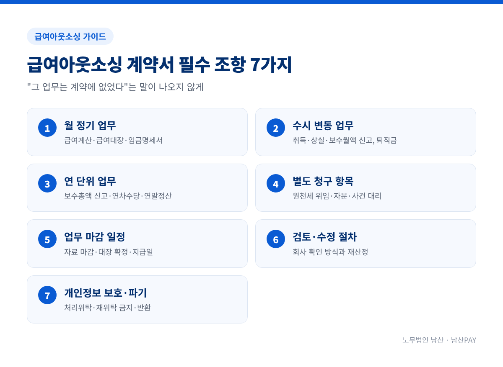

급여아웃소싱 계약서 작성의 원칙은 명확합니다. 나중에 <strong>"그 업무는 계약에 없었다"는 말이 나오지 않을 정도로 업무 범위와 협업 기준을 구체적으로 명시</strong>해야 합니다. 특히 각종 신고의 주체, 기초 자료 마감일, 그리고 급여 확정 및 수정 절차는 단 한 줄도 빠져서는 안 됩니다.

### 계약서 날인 전 반드시 체크할 7가지 필수 조항

1. <strong>월 정기 업무:</strong> 매월 진행되는 급여계산, 급여대장 산출, 임금명세서 작성 및 교부(전달) 방식을 명확히 적습니다.
2. <strong>수시 변동 업무:</strong> 4대보험 취득·상실·보수월액 변경 신고, 중도 입·퇴사자 일할 계산 및 정산, 퇴직금 산정 업무의 포함 여부를 확인합니다.
3. <strong>연 단위 업무:</strong> 매년 발생하는 4대보험 보수총액 신고, 연차미사용수당 정산, 그리고 연말정산(위임 여부)을 구분해 명시합니다.
4. <strong>별도 청구 항목:</strong> 원천세 신고 위임, 상시 인사노무 자문, 노동청 진정·근로감독 사건 대리 등 별도 비용이 발생하는 영역을 사전에 선을 그어 두어야 합니다.
5. <strong>업무 마감 일정:</strong> 회사가 근태·인사 자료를 넘기는 마감일, 업체가 급여대장을 전달하고 회사가 확정하는 날짜, 실제 급여 지급일을 타임라인으로 합의합니다.
6. <strong>검토 및 수정 절차:</strong> 급여대장 초안 전달 후 회사의 최종 확인 방식과, 변동 사항이나 착오가 발견되었을 때의 신속한 수정·재산정 절차를 정해 둡니다.
7. <strong>개인정보 보호 및 파기:</strong> 급여 데이터 위탁에 따른 개인정보 처리위탁 조항, 무단 재위탁 금지, 그리고 계약 종료 시 보유 자료의 즉시 반환 및 파기 의무를 넣어야 합니다.

### 자주 묻는 질문 (FAQ)
<strong>Q. 개인정보 처리위탁 계약서는 본 계약서와 별도로 작성해야 하나요?</strong>  
개인정보 보호법 제26조에 따라 업무 위탁 시에는 반드시 문서로 관련 사항을 정해야 합니다. 별도 계약서를 작성할 수도 있지만, 본 아웃소싱 계약서 내에 법정 필수 조항을 포함해 체결해도 효력이 동일합니다.

<strong>Q. 계약서에 없는 돌발 업무를 요청해야 할 때는 어떻게 되나요?</strong>  
계약 체결 시 별도 업무 항목과 협의 기준을 미리 명시해 두면, 돌발 이슈가 생겼을 때마다 비용이나 가능 여부를 두고 불필요하게 다투는 일을 막을 수 있습니다.

> <strong>급여아웃소싱 상담</strong>  
> 노무법인 남산 급여아웃소싱팀 이슬 팀장 · 02-585-7747~8 · namsan@namsanhr.com · namsanpay.com
