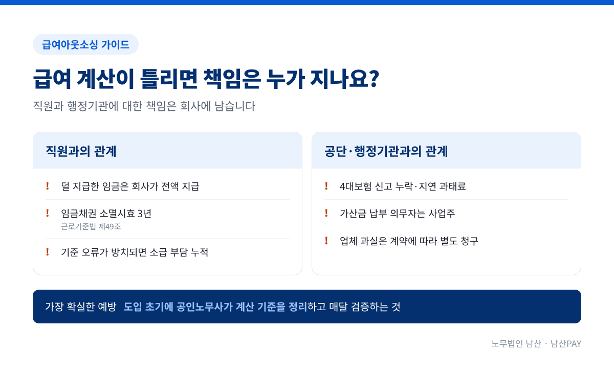

결론부터 분명히 말씀드리면, <strong>직원과 행정기관에 대한 법적 책임은 회사가 집니다.</strong> 급여를 외부에 맡겼더라도 적게 지급된 임금은 회사가 직원에게 지급해야 하며, 제때 정산하지 않으면 대표이사에게 임금체불 책임이 발생합니다. 따라서 사후에 책임을 따지는 것보다 <strong>애초에 오류가 발생하지 않는 검증된 파트너를 선택하는 것</strong>이 무엇보다 중요합니다.

### 급여·신고 오류 발생 시 회사가 떠안는 2가지 법적 리스크

* <strong>직원과의 관계 (임금체불 리스크):</strong> 덜 지급된 수당이나 퇴직금은 회사가 전액 지급해야 합니다. 근로기준법 제49조상 임금 채권의 소멸시효는 <strong>3년</strong>이므로, 잘못된 계산 기준이 수년간 방치되면 회사가 한꺼번에 감당해야 할 소급 정산 부담이 눈덩이처럼 커집니다.
* <strong>공단·행정기관과의 관계 (과태료·가산금):</strong> 4대보험 취득·상실 신고 누락이나 지연으로 부과되는 과태료와 가산금의 법적 납부 의무자는 사업주입니다.

### 오류 리스크를 원천 차단하는 가장 확실한 방법
급여 사고를 막는 유일한 해법은 <strong>처음부터 노동법 기준에 맞춰 계산 구조를 정확히 세팅하고, 매달 체계적인 교차 검증을 거치는 것</strong>입니다. 어떤 수당을 통상임금에 넣을지, 어떤 상여금을 퇴직금 평균임금에 포함할지처럼 법적 판단이 필요한 영역을 공인노무사가 도입 초기에 명확히 정리해 두어야 매달 같은 오류가 반복되지 않습니다.

<strong>노무법인 남산은 18년간 다양한 업종의 급여와 4대보험을 관리하면서 과태료 처분 등 행정상 문제없이 안정적으로 운영해 왔습니다.</strong> 철저한 사전 기준 검토와 마감 검증 프로세스가 곧 대표자의 법적 리스크를 지키는 가장 강력한 안전장치입니다.

### 자주 묻는 질문 (FAQ)
<strong>Q. 예전에 이용하던 업체나 사내 담당자가 계산을 틀린 사실을 지금 발견하면 어떻게 해야 하나요?</strong>  
우선 누락된 기간과 정확한 차액부터 산정하고, 직원에게 합법적으로 정산·지급할 방안을 마련해 임금체불 리스크를 조기에 해소하는 것이 가장 안전합니다.

<strong>Q. 계산 오류로 직원이 먼저 노동청에 진정을 넣었다면 어떻게 대응해야 하나요?</strong>  
감정적으로 대응하기보다 임금 산정 근거 자료를 객관적으로 정리해 노동청에 소명하고, 실제 차액이 확인된다면 지체 없이 정산해 사건을 조기에 종결하는 것이 최선입니다. 노무법인에 급여를 맡기고 있다면 이 전 과정을 담당 노무사가 원스톱으로 대응할 수 있습니다.

> <strong>급여아웃소싱 상담</strong>  
> 노무법인 남산 급여아웃소싱팀 이슬 팀장 · 02-585-7747~8 · namsan@namsanhr.com · namsanpay.com
