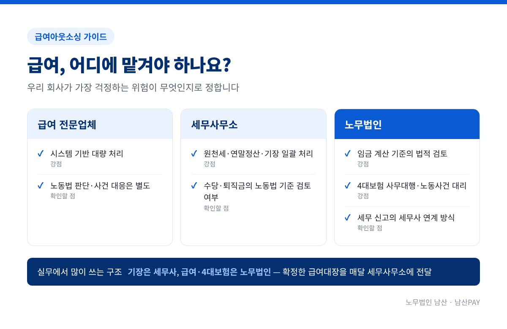

급여를 어디에 맡길지는 <strong>현재 우리 회사가 가장 우려하는 리스크가 무엇인지</strong>로 결정하면 명확합니다. 세금과 기장 연계가 최우선이라면 세무사무소, <strong>노동법 준수와 임금 분쟁 예방이 최우선이라면 노무법인</strong>이 정답입니다.

### 아웃소싱 기관 유형별 장단점 비교

| 기관 유형 | 핵심 강점 | 계약 전 반드시 확인할 점 |
| :--- | :--- | :--- |
| <strong>급여 전문업체</strong> | 전용 시스템 기반의 대규모·반복 처리 효율성 | 노동법적 해석·판단 및 노동청 사건 대응은 불가(별도) |
| <strong>세무사무소</strong> | 원천세 신고·연말정산·회계 기장과 일괄 처리 가능 | 연장수당·통상임금·퇴직금의 노동법 기준 검토 여부 |
| <strong>노무법인</strong> | 임금 계산 기준의 법적 검토, 4대보험 사무대행, 노동사건 대리 | 세무 신고(원천세·연말정산)의 세무사 연계 방식 |

### 실무에서 가장 많이 쓰이는 '기장·급여 분리' 구조
규모가 커지거나 근무형태가 다양해질수록 많은 기업이 <strong>회계 기장은 세무사에게, 급여와 4대보험은 노무법인에 맡기는 구조</strong>로 전환합니다. 노무법인이 노동법 기준에 맞춰 매달 급여대장을 최종 확정해 세무사무소에 전달하면, 세무 리스크와 노무 리스크를 각 분야의 전문가가 빈틈없이 방어할 수 있기 때문입니다.

### 노무법인 선택 시 필수 확인: 보험사무대행기관 인가 여부
노무법인에 급여를 맡길 때는 해당 법인이 <strong>근로복지공단의 보험사무대행기관 인가</strong>를 받았는지 확인해야 합니다. 인가 기관이어야 고용·산재보험 신고 업무를 적법하고 안정적으로 대행할 수 있습니다. <strong>노무법인 남산은 근로복지공단 인가를 받은 보험사무대행기관</strong>이며, 18년간 과태료 처분 등 문제없이 급여를 관리해 온 노하우를 바탕으로 급여 계산부터 4대보험, 노무 이슈 대응까지 공인노무사가 원스톱으로 해결합니다.

### 자주 묻는 질문 (FAQ)
<strong>Q. 세무와 노무를 한 곳에 전부 맡길 수는 없나요?</strong>  
원스톱 대행을 표방하는 곳도 있지만, 실제 내부에서 <strong>세무 신고와 노동법적 판단을 각각의 자격 전문가(세무사·공인노무사)가 직접 검토하는지</strong> 반드시 확인하셔야 합니다.

<strong>Q. 그동안 세무사무소에서 급여를 처리해 왔는데 꼭 바꿔야 하나요?</strong>  
고정 월급제 위주의 단순한 임금체계라면 큰 문제가 없는 경우도 많습니다. 다만 <strong>연장·야간·휴일근로나 교대근무가 발생하거나, 수당 항목이 여러 개라면</strong> 현재 계산 기준이 근로기준법에 맞는지 노무법인에 한 번 점검받아 보시는 것이 안전합니다.

> <strong>급여아웃소싱 상담</strong>  
> 노무법인 남산 급여아웃소싱팀 이슬 팀장 · 02-585-7747~8 · namsan@namsanhr.com · namsanpay.com
