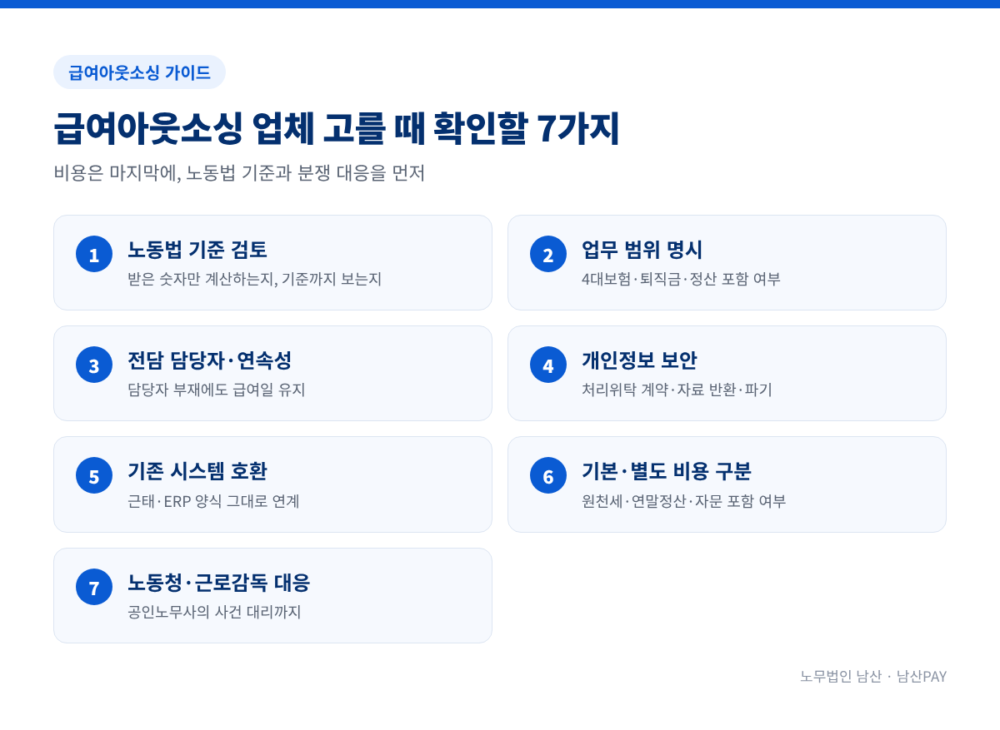

급여아웃소싱 업체를 고를 때 <strong>비용은 가장 마지막에 비교해도 늦지 않습니다.</strong> 대표자와 인사팀장이 최우선으로 확인해야 할 것은 단 두 가지입니다. <strong>'우리 회사 급여를 최신 노동법 기준에 맞춰 정확히 계산하는가'</strong>, 그리고 <strong>'노동법 이슈나 분쟁이 생겼을 때 누가 전문적으로 대응할 수 있는가'</strong>입니다.

급여 계산의 작은 오류는 단순한 행정 실수로 끝나지 않습니다. 수당 누락이나 통상임금 산정 오류는 곧바로 <strong>임금체불</strong>로 이어지며, 이는 근로기준법상 <strong>대표이사의 형사책임</strong>으로 직결됩니다. 단순히 숫자만 입력해 주는 대행사가 아니라, 회사의 노무 리스크를 방어할 수 있는 파트너를 고르기 위한 7가지 실무 기준을 정리했습니다.

### 1. 받은 숫자만 계산하는가, '노동법 기준'을 검토하는가
많은 기업이 급여를 맡기면 법적 문제가 알아서 해결된다고 생각하지만, 일반 대행사는 회사가 넘긴 근태·임금 데이터를 그대로 입력해 계산만 하는 경우가 많습니다. 통상임금과 평균임금의 산입 범위, 연장·야간·휴일근로수당, 연차미사용수당의 산정 방식 자체가 노동법에 맞는지 <strong>공인노무사가 사전에 검토해 주는 구조인지</strong> 반드시 확인해야 합니다.

### 2. 기본 업무 범위가 명확히 기재되어 있는가
계약 전에는 '급여 일체'라고 해놓고, 막상 시작하면 항목마다 추가 비용을 요구하는 사례가 빈번합니다. 급여계산과 임금명세서 작성은 기본이고, <strong>4대보험 취득·상실·보수월액 변경 신고, 중도 입·퇴사자 정산, 퇴직금 산정</strong>까지 월 기본 수수료에 포함되는지 확인하십시오.

### 3. 전담 담당자 배정 및 업무 연속성이 보장되는가
회사의 임금체계와 수당 히스토리를 모르는 담당자가 매달 바뀌면 오류율은 급격히 높아집니다. 매달 우리 회사를 전담해 관리하는 인력이 지정되는지, 그리고 그 담당자가 휴가나 퇴사로 자리를 비우더라도 <strong>내부 매뉴얼과 백업 시스템을 통해 급여일이 흔들리지 않는지</strong> 살펴야 합니다.

### 4. 민감한 개인정보와 연봉 데이터의 보안 체계
급여 자료에는 전 직원의 연봉, 계좌번호, 주민등록번호 등 회사에서 가장 민감한 개인정보가 담겨 있습니다. 개인정보 보호법에 따른 <strong>개인정보 처리위탁 계약</strong>을 체결하는지, 자료 전달 시 암호화 등 보안 프로토콜을 지키는지, 계약 종료 후 자료 반환 및 파기 절차가 명확한지 점검해야 합니다.

### 5. 기존 근태·ERP 시스템과의 호환성
아웃소싱을 도입하려는데 업체 전용 프로그램으로 전부 바꾸라고 요구하면 사내 저항과 추가 비용이 발생합니다. 현재 회사에서 사용 중인 <strong>근태관리 시스템이나 ERP의 데이터 양식을 그대로 연계</strong>할 수 있는지, 별도의 프로그램 이용료가 청구되지 않는지 확인하십시오.

### 6. 기본 수수료와 별도 청구 항목의 경계
월 수수료가 지나치게 저렴하다면 별도 청구 항목을 꼼꼼히 따져봐야 합니다. <strong>원천세 신고, 연말정산, 보수총액 신고, 인사노무 자문</strong> 등이 기본 포함인지 선택 위임(별도 비용)인지 계약서에 명시되어 있어야 추후 불필요한 마찰을 막을 수 있습니다.

### 7. 노동청 진정·근로감독 발생 시 대응 역량
급여를 처리하다 보면 포괄임금제 유효성, 통상임금 재산정, 퇴직금 차액 등 잠재된 노무 리스크가 드러나는 경우가 많습니다. 이때 단순 대행사는 해결책을 제시할 수 없습니다. <strong>18년간 과태료 처분 등 문제없이 다양한 업종의 급여를 관리해 온 노무법인 남산</strong>처럼, 문제가 발견되었을 때 즉시 임금체계 개선안을 제시하고 <strong>근로감독이나 노동청 진정이 들어왔을 때 사건 대리까지 공인노무사가 원스톱으로 대응할 수 있는 곳</strong>인지 확인하는 것이 핵심입니다.

### 자주 묻는 질문 (FAQ)
<strong>Q. 비슷한 서비스라면 가장 저렴한 업체를 고르는 게 합리적이지 않나요?</strong>  
단가만 보고 선택했다가 4대보험 신고나 퇴직금 정산이 빠져 있어 사내 담당자가 이중으로 일하거나, 건별 추가 비용이 붙어 오히려 총비용이 커지는 경우가 많습니다. 반드시 동일한 업무 범위를 기준으로 견적을 비교하셔야 합니다.

<strong>Q. 급여를 맡기면 추후 근로감독 대응도 함께 맡길 수 있나요?</strong>  
노동청 진정이나 근로감독 사건 대리는 법적으로 <strong>공인노무사의 고유 업무</strong>입니다. 일반 급여 대행사나 세무사무소는 대리가 불가능합니다. 처음부터 노무법인에 급여아웃소싱을 맡기면, 우리 회사의 급여 구조와 데이터를 이미 파악하고 있는 노무사가 지체 없이 대응할 수 있습니다.

> <strong>급여아웃소싱 상담</strong>  
> 노무법인 남산 급여아웃소싱팀 이슬 팀장 · 02-585-7747~8 · namsan@namsanhr.com · namsanpay.com
