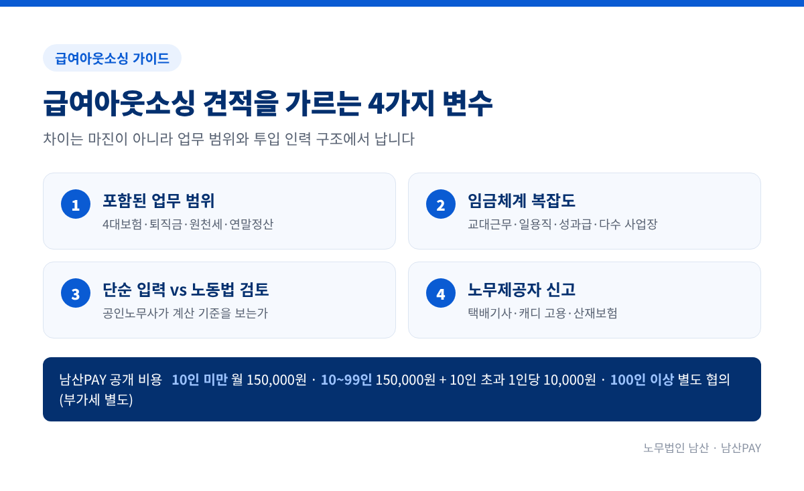

급여아웃소싱 견적을 여러 곳에 받아보면 같은 인원수인데도 금액 차이가 크게 벌어집니다. 결론부터 말씀드리면, <strong>견적의 차이는 '마진의 차이'가 아니라 '업무 범위와 전문 인력 투입 구조의 차이'</strong>에서 발생합니다. 월 단가 숫자만 나란히 놓고 비교하면 회사에 맞지 않는 업체를 고르게 됩니다.

### 견적 금액을 가르는 4가지 핵심 변수

1. <strong>포함된 업무의 범위:</strong> 단순 급여계산만 하는지, 4대보험 취득·상실 신고와 퇴직금 산정까지 묶여 있는지, 원천세 신고와 연말정산이 포함되는지에 따라 단가가 크게 달라집니다.
2. <strong>임금체계와 근무형태의 복잡도:</strong> 고정 월급제 중심의 사무직과 달리 교대근무, 일용직, 복잡한 성과급 구조, 다수 사업장을 운영하는 회사는 매달 검증해야 할 변수가 훨씬 많습니다.
3. <strong>'단순 입력'인가, '노동법 검토'인가:</strong> 회사가 보낸 엑셀 숫자만 계산기에 넣는 곳과, 수당 산정 기준이 최신 판례와 근로기준법에 부합하는지 <strong>공인노무사가 검토하는 곳</strong>은 서비스의 본질 자체가 다릅니다.
4. <strong>노무제공자(특고) 신고 여부:</strong> 택배기사, 캐디 등 노무제공자 고용·산재보험 신고는 일반 근로자 급여와 별도의 산정·신고 체계가 적용되므로 별도 기준이 필요합니다.

### '가장 싼 견적'이 결국 가장 비싼 선택이 되는 이유
급여 업무는 전산 프로그램만 돌린다고 끝나지 않습니다. 정확한 시스템 위에 <strong>실무 처리 담당자</strong>와 <strong>노동법 기준을 검증하는 공인노무사</strong>가 함께 붙어야 매달 오류 없는 급여가 나옵니다. 이 검증 구조를 갖추고도 시장 평균을 크게 밑도는 저가 견적을 제시하는 것은 현실적으로 어렵습니다.

<strong>18년간 과태료 처분 등 문제없이 다양한 업종의 급여를 운영해 온 남산PAY</strong> 고객사 중에서도, 비용 절감을 이유로 저가 업체로 이탈했다가 잦은 계산 오류와 불명확한 응대에 한계를 느끼고 다시 돌아온 사례가 적지 않습니다. 급여 한 번 잘못 계산되어 발생하는 임금체불 리스크와 직원 신뢰 하락은, 월 몇만 원 아낀 비용으로는 절대 만회할 수 없습니다.

### 남산PAY의 투명한 비용 기준
남산PAY는 불투명한 '상담 후 견적' 관행을 없애고 홈페이지에 표준 비용을 투명하게 공개하고 있습니다.

| 관리 인원 기준 | 월 기본 수수료 (부가세 별도) | 비고 |
| :--- | :--- | :--- |
| <strong>10인 미만</strong> | 월 150,000원 | 기본 구간 |
| <strong>10인 ~ 99인</strong> | 150,000원 + 10인 초과 1인당 10,000원 | 예: 30인 기준 월 350,000원 |
| <strong>100인 이상</strong> | 별도 협의 | 사업장 구조 맞춤 설계 |

* <strong>기본 포함 항목:</strong> 급여계산, 4대보험 신고, 퇴직금 산정, <strong>공인노무사의 계산 기준 검토</strong>  
* <strong>선택 위임 항목:</strong> 원천징수 신고, 연말정산 신고

### 자주 묻는 질문 (FAQ)
<strong>Q. 여러 업체의 견적을 가장 정확하게 비교하는 방법이 있나요?</strong>  
회사에서 필요한 항목(급여계산, 4대보험, 퇴직금, 원천세, 연말정산, 노무 검토 등)을 리스트로 만든 뒤, 각 업체에 <strong>'기본 포함 / 별도 비용 / 불가'</strong>를 체크해 달라고 요청하십시오. 같은 조건으로 맞춰야 진짜 비용이 보입니다.

<strong>Q. 매달 입·퇴사로 직원 수가 바뀌는데 비용은 어떻게 정산되나요?</strong>  
통상 해당 월의 실제 관리 인원을 기준으로 산정합니다. 중도 입·퇴사자 포함 여부 등 구체적인 인원 산정 기준일은 계약 시 명확히 합의하여 진행합니다.

> <strong>급여아웃소싱 상담</strong>  
> 노무법인 남산 급여아웃소싱팀 이슬 팀장 · 02-585-7747~8 · namsan@namsanhr.com · namsanpay.com
