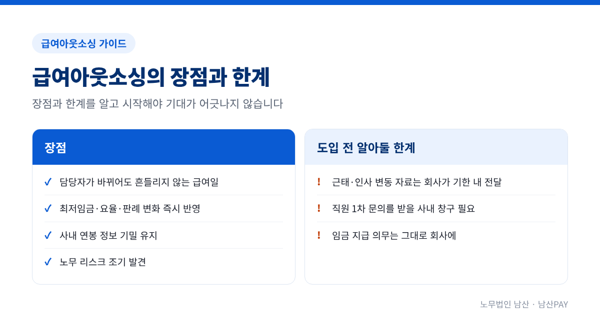

급여아웃소싱의 가장 큰 가치는 <strong>특정 담당자 한 사람에게 의존하던 급여 업무를 '사람이 바뀌어도 흔들리지 않는 시스템'으로 전환하는 것</strong>입니다. 반대로 명확한 한계는, 외부 파트너와 일하는 만큼 <strong>회사 내부의 근태·인사 변동을 정해진 기한 안에 자료로 전달해야 한다는 점</strong>입니다. 장점과 한계를 정확히 알고 도입해야 기대치 충돌을 줄일 수 있습니다.

### 급여아웃소싱 도입 시 얻는 4가지 장점

* <strong>흔들리지 않는 업무 연속성:</strong> 사내 담당자가 휴가를 가거나 갑자기 퇴사하더라도 매달 급여일과 4대보험 신고 기한이 정확히 지켜집니다.
* <strong>법 개정과 판례의 즉각적 반영:</strong> 매년 바뀌는 최저임금, 4대보험 요율, 통상임금 관련 대법원 판례 등 실무자가 놓치기 쉬운 변화가 급여에 바로 적용됩니다.
* <strong>사내 연봉 정보 기밀 유지:</strong> 대표자와 핵심 임원, 전 직원의 연봉 데이터가 사내 일반 직원에게 노출되는 것을 최소화합니다.
* <strong>노무 리스크의 조기 발견:</strong> 18년간 과태료 처분 등 문제없이 급여를 운영해 온 노무법인이 직접 관리하면, 매달 급여대장을 검토하는 과정에서 잠재된 노동법 위반 소지를 사건화되기 전에 미리 포착해 해결할 수 있습니다.

### 도입 전 반드시 인지해야 할 3가지 한계

* <strong>자료 전달 기한 준수 필수:</strong> 입·퇴사, 연장근로, 휴직 등 근태·인사 변동 자료는 회사가 제때 넘겨주어야 합니다. 기초 자료 전달이 늦어지면 급여 확정 일정도 함께 지연될 수밖에 없습니다.
* <strong>사내 소통 창구 필요:</strong> 직원이 본인 급여명세서에 대해 즉각적으로 질문할 때 1차로 응대하고 소통할 최소한의 사내 창구가 필요합니다.
* <strong>법적 책임의 최종 귀속:</strong> 계산과 신고를 위탁하더라도 근로기준법상 임금 지급 의무 자체는 회사에 남습니다. 아웃소싱을 맡겼다고 해서 사업주의 법적 책임이 자동으로 사라지는 것은 아닙니다.

### 자주 묻는 질문 (FAQ)
<strong>Q. 계약 후 실제 도입까지 시간이 오래 걸리나요?</strong>  
기존 급여대장과 근로계약서 등 기초 자료가 준비되어 있다면, 대부분 <strong>바로 다음 달 급여일부터 정상적으로 시작</strong>할 수 있습니다.

<strong>Q. 도입해 보고 맞지 않으면 중간에 해지할 수 있나요?</strong>  
가능합니다. 다만 불필요한 분쟁을 막기 위해 계약 전 <strong>중도 해지 통보 기간과 계약 종료 시 자료 반환 조항</strong>을 미리 확인해 두시는 것이 좋습니다.

> <strong>급여아웃소싱 상담</strong>  
> 노무법인 남산 급여아웃소싱팀 이슬 팀장 · 02-585-7747~8 · namsan@namsanhr.com · namsanpay.com
