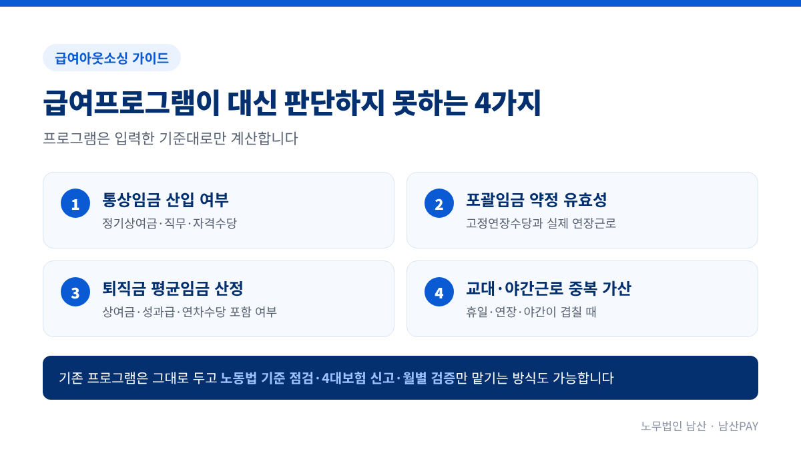

많은 대표님이 좋은 급여프로그램(ERP)을 도입하면 급여 오류가 사라질 것이라 기대합니다. 하지만 <strong>프로그램은 사람이 입력해 둔 기준대로만 계산할 뿐입니다.</strong> 초기 세팅 기준 자체가 노동법에 어긋나 있다면, 프로그램은 매달 <strong>'틀린 금액을 아주 정확하고 빠르게'</strong> 뽑아낼 뿐입니다.

### 프로그램이 대신 판단해 주지 못하는 4가지 법적 영역

전산 시스템은 사칙연산은 완벽하지만, 아래의 노동법적 판단은 결코 대신해 줄 수 없습니다.

1. <strong>통상임금 산입 여부:</strong> 정기상여금이나 각종 직무·자격수당 중 무엇을 통상임금에 포함해 연장수당의 기준으로 삼을지 판단해야 합니다.
2. <strong>포괄임금 약정의 유효성:</strong> 고정연장수당을 지급하고 있을 때, 실제 연장근로 시간이 약정 시간을 초과하지 않는지, 포괄임금 계약 자체가 법적으로 유효한지 검토해야 합니다.
3. <strong>퇴직금 평균임금 산정:</strong> 퇴직 직전 3개월 급여 외에 연간 지급된 상여금·경영성과급·연차수당 중 어떤 항목을 평균임금에 합산할지 판례 기준에 따라 판단해야 합니다.
4. <strong>교대근무·야간근로의 복합 가산:</strong> 휴일근로와 연장·야간근로가 겹칠 때 중복 가산율을 어떻게 적용할지 정교한 기준 설정이 필요합니다.

### 기존 시스템을 버리지 않는 실용적인 대안
이미 사내에 안착된 급여·근태 프로그램을 억지로 바꿀 필요는 없습니다. 기존 프로그램의 데이터 양식을 그대로 유지하면서 <strong>노동법 기준 점검과 4대보험 신고, 월별 검증만 노무법인에 맡기는 방식</strong>으로도 충분히 안전하게 운영할 수 있습니다.

### 자주 묻는 질문 (FAQ)
<strong>Q. 아웃소싱을 맡기려면 지금 쓰는 급여·근태 프로그램을 반드시 바꿔야 하나요?</strong>  
꼭 그렇지 않습니다. 상담 단계에서 현재 사용 중인 프로그램의 추출 양식을 확인하고, 사내 업무 혼선을 최소화하는 연동·전달 방식을 맞춰 진행합니다.

<strong>Q. 전산 프로그램으로 자동 계산을 돌리면 오류가 줄어드는 건 사실 아닌가요?</strong>  
단순 덧셈·뺄셈 같은 산술적 실수는 확실히 줄어듭니다. 그러나 법적 해석이 잘못된 '기준 오류'는 전산화가 될수록 오히려 매달 빠짐없이 누적되므로 반드시 노무사의 검증이 필요합니다.

> <strong>급여아웃소싱 상담</strong>  
> 노무법인 남산 급여아웃소싱팀 이슬 팀장 · 02-585-7747~8 · namsan@namsanhr.com · namsanpay.com
