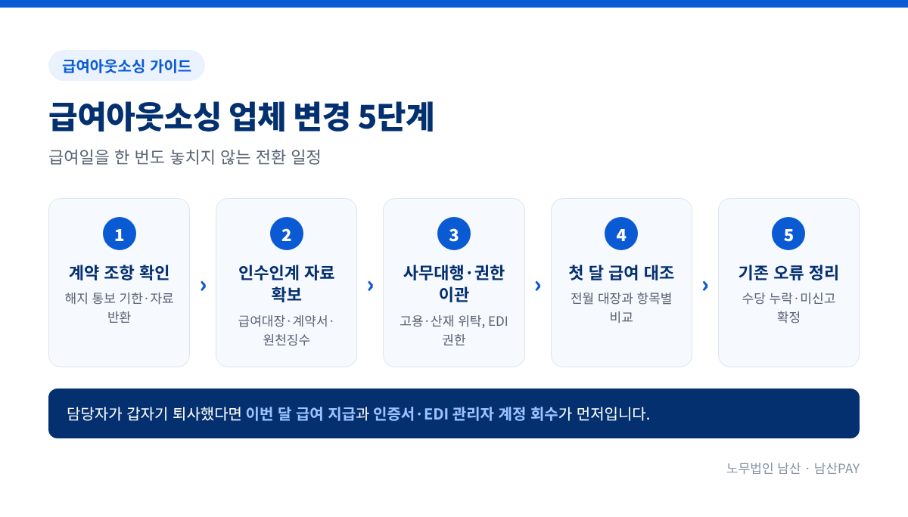

급여아웃소싱 업체 변경의 핵심은 <strong>급여일을 단 한 번도 놓치지 않는 것</strong>입니다. 기존 업체와의 계약 종료일, 새 업체의 업무 개시일, 그리고 4대보험 사무대행 위탁 변경일을 한 달 일정 안에 정확히 맞물리게 설계하면 업무 공백 없이 안전하게 전환할 수 있습니다.

### 무중단 업체 변경을 위한 5단계 체크리스트

1. <strong>기존 계약의 해지 및 반환 조항 확인</strong>  
   먼저 현재 계약서의 해지 통보 기한과 계약 종료 시 자료 반환 조항을 점검해야 합니다. 통상 1~2개월 전 사전 통보 조건이 붙는 경우가 많아 일정 역산이 필수적입니다.
2. <strong>필수 인수인계 자료 확보</strong>  
   새 업체가 정확한 계산 기준을 세울 수 있도록 <strong>최근 1년치 급여대장, 근로계약서, 취업규칙·임금규정, 퇴직연금 가입 내역, 4대보험 취득 명부, 당해 연도 원천징수 내역</strong>을 미리 확보해 두십시오.
3. <strong>4대보험 사무대행 및 시스템 권한 이관</strong>  
   고용·산재보험 사무대행 위탁을 새 기관으로 변경하고, 기존 업체가 보유한 4대보험 EDI 및 관련 포털 관리자 권한을 깔끔하게 정리합니다.
4. <strong>전환 첫 달 급여 대사(대조) 검증</strong>  
   새 업체가 산출한 첫 달 급여대장을 전월 급여대장과 항목별로 1:1 대조해야 합니다. 금액 차이가 발생했다면 단순 입력 착오인지, 기존 업체의 계산 기준 자체가 틀렸던 것인지 이 시점에 명확히 규명해야 합니다.
5. <strong>기존 오류 및 잠재 리스크 정리</strong>  
   18년간 다양한 업종의 급여를 인수해 온 경험상, 업체 변경 과정에서 <strong>수당 누락이나 4대보험 미신고</strong>가 발견되는 사례가 매우 많습니다. 인수 시점에 기존 오류를 확정하고 정리해 두어야 추후 불필요한 혼선과 리스크를 막을 수 있습니다.

### 급여 담당자가 갑자기 퇴사한 경우라면?
사내 담당자의 갑작스러운 퇴사로 급여아웃소싱을 긴급 도입할 때도 큰 흐름은 동일합니다. 다만 이 경우 가장 시급한 것은 <strong>이번 달 급여를 제때 지급하는 것</strong>과 <strong>공동인증서·급여 프로그램·4대보험 EDI 관리자 계정을 최우선으로 회수하는 것</strong>입니다. 노무법인이 직접 운영하는 남산PAY는 긴급 인수 상황에서도 급여 계산부터 4대보험 이관, 기존 임금체계 오류 진단까지 공인노무사가 원스톱으로 정리해 드립니다.

### 자주 묻는 질문 (FAQ)
<strong>Q. 연말이 아니라 연중에 업체를 바꿔도 연말정산에 문제가 없나요?</strong>  
문제가 없습니다. 기존 업체나 사내에서 처리한 <strong>올해 원천징수 내역</strong>만 정확히 인계받으면, 연말정산까지 끊김 없이 이어서 진행할 수 있습니다.

<strong>Q. 기존 업체가 협조하지 않고 자료를 넘겨주지 않으면 어떻게 하나요?</strong>  
급여대장과 4대보험 신고 내역은 회사의 고유 자료입니다. 만약 기존 업체와 소통이 원활하지 않더라도, 4대보험 신고 이력은 공단 사이트를 통해 회사 권한으로 직접 재발급받을 수 있습니다.

> <strong>급여아웃소싱 상담</strong>  
> 노무법인 남산 급여아웃소싱팀 이슬 팀장 · 02-585-7747~8 · namsan@namsanhr.com · namsanpay.com
