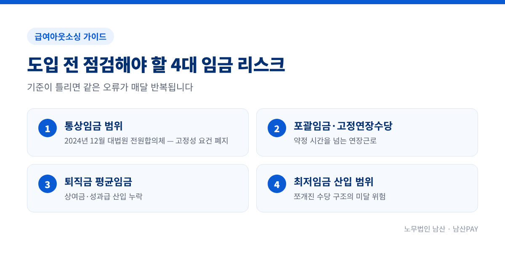

현재 회사의 임금체계에 법적 결함이 있다면, 급여아웃소싱을 도입하더라도 <strong>같은 오류가 매달 꼬박꼬박 반복</strong>될 뿐입니다. 아웃소싱을 시작하는 시점에 공인노무사에게 임금체계를 한 번 제대로 점검받는 것이, 향후 발생할 임금체불 분쟁 비용을 줄이는 가장 저렴하고 확실한 방법입니다.

### 도입 전 반드시 진단해야 할 4대 임금 리스크

1. <strong>통상임금 범위의 변화 (2024년 대법원 전원합의체 판결 반영)</strong>  
   2024년 12월 대법원 전원합의체 판결로 통상임금의 '고정성' 요건이 폐지되었습니다. 기존에 통상임금에서 제외해 왔던 <strong>재직 조건부 상여금이나 특정 근무일수 조건부 수당</strong>도 통상임금에 포함될 수 있어, 연장·야간·휴일수당과 연차수당의 기준 금액이 전면 달라질 수 있습니다.
2. <strong>포괄임금제 및 고정연장수당 초과분</strong>  
   매달 일정 시간의 연장근로를 가정해 고정연장수당을 지급하고 있다면, 직원의 실제 연장근로가 약정 시간을 초과하지 않는지 점검해야 합니다. 초과한 시간에 대해서는 반드시 추가 수당을 지급해야 합니다.
3. <strong>퇴직금 평균임금 산입 누락</strong>  
   정기 상여금이나 성과급 가운데 법적으로 퇴직금 평균임금에 들어가야 할 항목을 관행적으로 빼고 계산해 퇴직금 차액 분쟁이 발생하는 사례가 매우 많습니다.
4. <strong>최저임금 산입 범위 오류</strong>  
   기본급 비중을 낮추고 복리후생적 수당을 여러 개 쪼개 놓은 임금 구조는, 최저임금 산입 범위 규정에 걸려 의도치 않은 최저임금 위반으로 이어지기 쉽습니다.

### 단순 진단을 넘어 '정리와 개편'까지 원스톱으로
점검 결과 잠재된 리스크가 발견되었다면, <strong>과거에 누적된 차액을 어떻게 합법적으로 정리할지</strong>와 <strong>앞으로의 임금체계를 어떻게 안전하게 개편할지</strong>를 동시에 설계해야 합니다. 이 영역은 일반 급여 대행사가 아닌 <strong>18년 업력의 공인노무사</strong>만이 법적 근거를 가지고 해결할 수 있습니다.

### 자주 묻는 질문 (FAQ)
<strong>Q. 임금체계를 점검하다가 의도치 않은 임금체불이 발견되면 회사에 불리하지 않나요?</strong>  
전혀 그렇지 않습니다. 회사가 선제적으로 오류를 발견해 적법하게 정리하고 구조를 개선하는 것이, 추후 퇴사자의 노동청 진정이나 예고 없는 근로감독으로 적발되어 형사처벌·가산이자 부담을 떠안는 것보다 훨씬 유리하고 안전합니다.

<strong>Q. 임금체계 사전 점검에는 시간이 얼마나 걸리나요?</strong>  
회사의 임금 항목 개수, 근무형태(교대제·탄력근무 등)의 복잡도, 기존 급여대장과 근로계약서 자료의 정리 상태에 따라 달라집니다. 상담 시 자료를 확인한 뒤 정확한 일정을 안내해 드립니다.

> <strong>급여아웃소싱 상담</strong>  
> 노무법인 남산 급여아웃소싱팀 이슬 팀장 · 02-585-7747~8 · namsan@namsanhr.com · namsanpay.com
