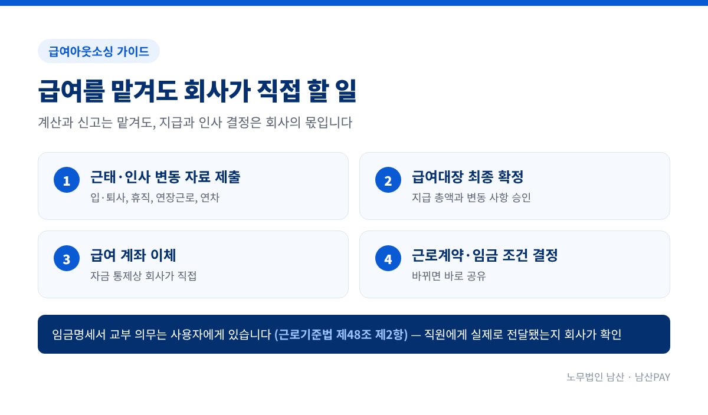

급여아웃소싱을 도입하면 복잡한 계산과 신고 실무에서 해방되지만, <strong>임금 지급과 인사 의사결정 권한은 여전히 회사에 있습니다.</strong> 아웃소싱 도입 후 업무가 매끄럽게 돌아가기 위해 회사가 반드시 직접 챙겨야 할 4가지 핵심 역할을 정리했습니다.

### 회사가 직접 챙겨야 할 4가지 필수 업무

1. <strong>근태 및 인사 변동 자료의 적기 제출</strong>  
   신규 입사, 퇴사, 휴직, 연장·야간·휴일근로 시간, 연차 사용 내역 등 현장에서 발생한 변동 사항은 회사만 알 수 있습니다. 약속된 마감일까지 정확한 기초 자료를 전달하는 것이 오류 없는 급여의 출발점입니다.
2. <strong>급여대장 최종 검토 및 확정 승인</strong>  
   업체가 산출한 급여대장은 '초안'입니다. 지급 총액과 주요 변동 사항을 확인하고 최종 지급을 승인(확정)하는 주체는 반드시 회사여야 합니다.
3. <strong>실제 급여 계좌 이체</strong>  
   보안과 자금 통제 원칙상, 확정된 급여대장을 바탕으로 은행에서 실제 급여를 이체하는 업무는 대부분 회사가 직접 진행합니다.
4. <strong>근로계약서 작성 및 임금 조건 결정</strong>  
   직원의 연봉 인상, 수당 신설, 소정근로시간 변경 등 모든 근로조건을 결정하는 권한은 회사에 있습니다. 임금 조건이 바뀔 때마다 급여 담당 노무법인에 즉시 공유해 주셔야 급여대장에 정확히 반영됩니다.

### 놓치기 쉬운 법적 의무: 임금명세서 교부
근로기준법 제48조 제2항에 따라 <strong>임금명세서 교부 의무는 사용자(회사)</strong>에게 있습니다. 명세서 작성 자체는 아웃소싱 업체에 맡길 수 있지만, 작성된 명세서가 급여일에 맞춰 직원 개개인에게 실제로 도달했는지 최종 확인하는 것은 회사의 몫입니다.

### 자주 묻는 질문 (FAQ)
<strong>Q. 사내 사정으로 근태 자료를 마감일보다 늦게 넘기면 어떻게 되나요?</strong>  
급여일에 맞춰 정확한 검증을 마치기 어려워지거나, 변동분만 다음 달 급여에서 소급 정산하는 방식으로 처리하게 됩니다. 원활한 지급을 위해 계약 시 현실적인 자료 마감일을 정해 두는 것이 중요합니다.

<strong>Q. 직원이 본인 급여 계산에 대해 문의하면 누가 응대하나요?</strong>  
일반적으로 사내 담당자가 1차 문의를 접수하고, 법적 해석이나 세부 산정 근거 설명이 필요한 부분만 노무법인에 전달해 답변을 받아 안내하는 방식이 가장 효율적입니다.

> <strong>급여아웃소싱 상담</strong>  
> 노무법인 남산 급여아웃소싱팀 이슬 팀장 · 02-585-7747~8 · namsan@namsanhr.com · namsanpay.com
